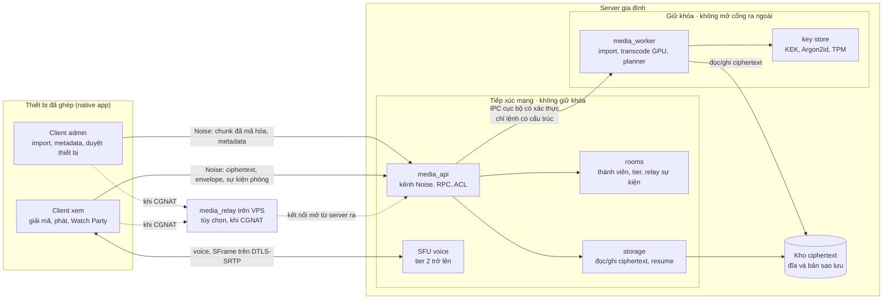
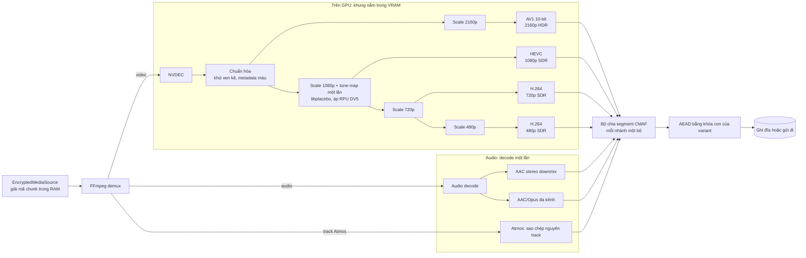

# Home Media Server mã hóa — Thiết kế tổng quan v0.2

Cập nhật lần cuối 17/10/2026. Đây là bản thiết kế duy nhất, duy trì trong repo.

Media server gia đình mã nguồn mở bằng C++20, kiểu Plex. Server do admin gia đình vận hành, được tin cậy để quản lý thư viện và transcode bằng GPU. Mã hóa bảo vệ tài sản của gia đình khỏi người ngoài, khách không được chia sẻ, thiết bị bị thu hồi, và việc lộ ổ cứng hay bản sao lưu.

Trạng thái: bản nháp thảo luận; mã nguồn ở giai đoạn benchmark, chưa có repo git. Nhiều mục còn mở, xem mục 16.

## Thay đổi so với v0.1

| Khu vực | v0.1 | v0.2 |
| --- | --- | --- |
| Mô hình tin cậy | E2EE chặt: server không bao giờ có khóa | Server gia đình tin cậy khi đang chạy; dữ liệu mã hóa khi lưu, khi truyền và theo từng thiết bị |
| Transcode | Cấm trên server | GPU server transcode (NVENC), tone-map HDR sang SDR |
| Năng lực client | Không có | Hồ sơ năng lực thiết bị quyết định bậc rendition và luồng được gửi |
| Video | Một file gốc, đọc theo chunk | Original + rendition đa phân giải CMAF, ABR |
| Quản lý thư viện | Client tự import | Admin gia đình import, quản lý metadata, chia sẻ; thành viên có thư viện cá nhân |
| Watch Party | Đồng bộ play/pause/seek | Thêm chat, reaction, yêu cầu tạm dừng, voice; tối đa 15 người, 4 tier |
| Threat model | Chống cả server | Không chống server đang chạy bị chiếm quyền hay admin; chống mọi bên còn lại |
| Kênh truyền | TLS | Noise thay TLS, chỉ có native app, ghép thiết bị bằng QR/token do admin cấp |

## 1. Mục tiêu và phạm vi

### Yêu cầu chức năng

- Admin gia đình quản lý thư viện phim MKV, MP4, MOV: import, metadata, poster, chia sẻ.
- Upload file lớn hàng chục GB từ client admin, tiếp tục được khi mất kết nối.
- Phát chất lượng gốc, seek tới vị trí bất kỳ mà không tải hoặc giải mã toàn bộ file.
- Server transcode bằng GPU ra nhiều bậc phân giải, tone-map HDR sang SDR, dựa trên năng lực thực tế của các thiết bị.
- Mỗi thiết bị chỉ nhận luồng nó decode và hiển thị được; ví dụ thiết bị 720p SDR không bao giờ nhận luồng gốc HDR.
- Client Windows native trước, Android sau. Mọi client là native app; không có web client.
- Người dùng gia đình và khách được mời, chia sẻ theo từng asset, theo chính sách chia sẻ do admin đặt (mục 4.9).
- Xem riêng trên từng thiết bị, ngoài Watch Party; vị trí xem tiếp và lịch sử xem của từng người là riêng của người đó.
- Thành viên được admin cho phép upload phim vào thư viện cá nhân, có hạn mức dung lượng (mục 4.8).
- Metric và công cụ chẩn đoán cho server và client, chỉ lưu và xem trong hệ thống, không gửi ra ngoài (mục 11.4).
- Watch Party tối đa 15 người: đồng bộ phát, chat, reaction, tạm dừng để trò chuyện, voice; chat và voice mã hóa đầu cuối ở chế độ mặc định.
- Truy cập qua LAN và Internet với cùng một mô hình mã hóa.

### Yêu cầu phi chức năng

| Hạng mục | Yêu cầu |
| --- | --- |
| Ngôn ngữ / build | C++20, CMake |
| Server | Windows và Linux |
| Client | Windows native trước, Android sau (C++ core qua JNI) |
| CPU server | AVX2 trở lên (transcode phần mềm dự phòng, mã hóa) |
| GPU server | NVIDIA: NVDEC/NVENC cho transcode, CUDA và Vulkan cho tone-map; hãng khác qua HAL (mục 11.2, 11.3) |
| Media engine | FFmpeg |
| Rendering client | Vulkan |
| Mã hóa | Mọi dữ liệu trên đĩa và bản sao lưu là ciphertext; kênh Noise xác thực hai chiều trên đường truyền (mục 9); khóa nội dung cấp theo từng thiết bị |
| Plaintext phía server | Chỉ trong bộ nhớ của media worker khi chạy job; không bao giờ ghi xuống đĩa |
| Transcode phía server | Được phép, ưu tiên dựng sẵn rendition |
| Quy mô phòng | Tối đa 15 thành viên, có tier |

CPU AVX2 và GPU NVIDIA là điều kiện triển khai, không phải cơ chế bảo mật. Server cần chạy được ở chế độ không GPU (transcode CPU, chậm hơn), xác định qua bước kiểm tra cấu hình và benchmark.

## 2. Kiến trúc tổng thể

Server gồm hai phần tách tiến trình: dịch vụ API không giữ khóa, và media worker giữ khóa trong RAM để import, transcode và đọc metadata. Đĩa và bản sao lưu chỉ chứa ciphertext.



Client xem nhận ciphertext cùng key envelope của chính thiết bị, rồi tự giải mã. Vì vậy dịch vụ API vẫn phục vụ phát được khi key store đang khóa; chỉ import và transcode cần mở khóa. Voice ở tier 1 đi P2P giữa các client (mục 8).

Ranh giới quan trọng nhất nằm giữa dịch vụ API (tiếp xúc Internet) và media worker (giữ khóa): một lỗ hổng ở API không được dẫn thẳng tới khóa nội dung. Chi tiết ở mục 11 và 13.

## 3. Mô hình tin cậy và mã hóa

Server gia đình được tin cậy khi đang chạy; mã hóa đảm bảo mọi bản dữ liệu nằm ngoài bộ nhớ của server đang chạy và của thiết bị được cấp quyền đều là ciphertext. Đây không còn là E2EE theo nghĩa chặt, nên tài liệu gọi là mã hóa khi lưu, khi truyền và theo thiết bị.

### 3.1. Ai được tin

| Thành phần | Tin cậy | Ghi chú |
| --- | --- | --- |
| Admin gia đình | Có | Quản lý thư viện, khóa, thiết bị, chia sẻ |
| Media worker trên server | Có, khi đang chạy | Giữ khóa trong RAM khi chạy job |
| Dịch vụ API, relay, SFU | Hạn chế | Tiếp xúc Internet, không giữ khóa nội dung |
| Ổ đĩa, bản sao lưu | Không | Chỉ chứa ciphertext |
| Mạng LAN và Internet | Không | Kênh Noise, nội dung bên trong vẫn là ciphertext |
| Thiết bị được cấp quyền | Trong phạm vi quyền | Chỉ nhận khóa của asset được chia sẻ |
| Khách ngoài phạm vi, thiết bị bị thu hồi, người ngoài | Không |  |

### 3.2. Đơn vị mã hóa: chunk và segment

AEAD đề xuất: XChaCha20-Poly1305 qua libsodium. Một asset có hai loại đơn vị mã hóa:

| Loại | Dùng cho | Ranh giới | Kích thước |
| --- | --- | --- | --- |
| Byte chunk | Bản original | Cắt theo byte, có thể cắt ngang cấu trúc MKV/MP4 | Cố định khi mã hóa, nhỏ (ví dụ 1 MiB) |
| Media segment | Rendition đa phân giải | Theo segment CMAF/fMP4, bắt đầu bằng keyframe | GOP cố định 2–4 giây |

Mỗi đơn vị được xác thực độc lập. Đơn vị bị sửa trên đĩa, bị tráo hoặc dùng sai khóa phải bị từ chối trước khi tới demuxer.

Kích thước đơn vị lưu trữ được chọn một lần khi mã hóa và ghi trong manifest, vì đổi nó đồng nghĩa mã hóa lại toàn bộ asset. Thứ thay đổi theo từng kết nối là kích thước mỗi lần tải: khi client kết nối, hai bên thỏa thuận số đơn vị gộp trong một request, dựa trên hồ sơ năng lực và băng thông đo được. Ví dụ, gộp ít đơn vị trên mạng di động chập chờn, gộp 8–16 MiB khi xem qua LAN.

```
EncryptedAsset
├── Asset ID, Generation ID
├── Encrypted Manifest
├── Variant: original
│   └── Chunks: nonce + ciphertext + tag
└── Variant: rendition (vd. 1080p-SDR-H264, 720p-SDR-H264, audio-*, subs-*)
    ├── Init segment (mã hóa)
    └── Media segments: nonce + ciphertext + tag
```

### 3.3. Nonce và Associated Data

Không bao giờ tái sử dụng nonce với cùng khóa. Ghi lại một đơn vị thì giữ đúng ciphertext cũ hoặc mã hóa lại với nonce mới.

AAD ràng buộc tối thiểu: phiên bản định dạng, Asset ID, Generation ID, Variant ID, chỉ số đơn vị và độ dài plaintext, để phát hiện việc tráo đơn vị giữa asset, generation, variant hoặc vị trí.

### 3.4. Manifest

Manifest liệt kê các variant (codec, độ phân giải, dải động SDR/HDR, bitrate), số đơn vị, kích thước plaintext và thời điểm bắt đầu từng segment. Media worker tạo và đọc được manifest; trên đĩa nó luôn ở dạng mã hóa. Client vẫn xác thực manifest và kiểm tra số lượng, kích thước, chỉ số, overflow và giới hạn tài nguyên trước khi dùng.

### 3.5. Metadata

Tên phim, mô tả, poster, diễn viên và đường dẫn gốc của thư viện chung được media worker đọc để quản lý thư viện, nhưng lưu trên đĩa ở dạng mã hóa bằng khóa thư viện. Thiết bị chỉ nhận metadata của asset nó được chia sẻ.

Lịch sử xem, vị trí xem tiếp và metadata của asset trong thư viện cá nhân mã hóa bằng khóa người dùng (mục 4.1), đồng bộ giữa các thiết bị của người đó qua server; server và admin chỉ thấy ciphertext.

Thư viện không tra cứu nguồn bên ngoài. Admin nhập tên, mô tả, poster và các trường khác từ client app; server chỉ lưu và tạo thumbnail.

### 3.6. Padding

Chuỗi kích thước segment theo thời gian đủ để người quan sát mạng đoán phim, kể cả khi nội dung đã mã hóa. Padding trên kênh truyền bật mặc định: mỗi lần gửi được đệm lên bậc kích thước gần nhất (bậc tăng theo hàm mũ, kiểu Padmé) bên trong khung Noise, nên không tốn dung lượng lưu trữ (mục 9.3). Bậc cụ thể và chi phí băng thông chờ benchmark B2.

Padding khi lưu, để che cả trước người lấy được ổ đĩa, là tùy chọn, mặc định tắt vì tốn dung lượng.

## 4. Quản lý khóa và quyền truy cập

Mọi khóa nội dung trên đĩa đều được bọc bởi một khóa gốc (KEK) do admin mở; thiết bị nhận khóa qua envelope riêng, nên vẫn phát được khi key store đang khóa.

### 4.1. Cây khóa

```
Passphrase admin (Argon2id) và/hoặc TPM
└── Server KEK (key store, chỉ media worker dùng)
    ├── Library key: mã hóa metadata thư viện chung, lịch sử chat Memorize!
    └── Asset DEK (mỗi generation)
        ├── Bọc bằng KEK: cho media worker (transcode, tạo rendition mới)
        └── Envelope cho từng thiết bị được cấp quyền

Khóa người dùng (mỗi người một khóa, không nằm dưới KEK)
├── Bọc cho từng thiết bị của người đó
├── Mã hóa lịch sử xem, vị trí xem tiếp, metadata thư viện cá nhân
└── Bọc DEK của asset "kín" trong thư viện cá nhân (mục 4.8)
```

Khóa người dùng được tạo trên thiết bị đầu tiên của người đó. Thiết bị mới của cùng người nhận khóa khi một thiết bị cũ còn online bọc lại cho nó, sau khi người dùng xác nhận trên thiết bị cũ; admin duyệt thiết bị (mục 9.2) nhưng không cấp được khóa này. Người dùng có thể tạo mã khôi phục riêng, giống bộ khôi phục của admin. Mất mọi thiết bị mà không có mã khôi phục thì mất lịch sử xem và các asset kín; asset cá nhân thường vẫn còn vì DEK được bọc bằng KEK.

### 4.2. Key store

- KEK được dẫn xuất từ passphrase admin bằng Argon2id, hoặc niêm phong bằng TPM, hoặc cả hai (mục 16).
- Khi khởi động, key store ở trạng thái khóa. Admin mở khóa từ client admin hoặc tại máy server.
- Chỉ tiến trình media worker truy cập được KEK; dịch vụ API không có.
- Khi key store khóa: phát, chia sẻ asset đã có envelope và Watch Party vẫn hoạt động. Import, transcode và cấp envelope cho thiết bị mới phải chờ mở khóa.

### 4.3. Khóa thiết bị

Mỗi thiết bị có cặp khóa riêng; khóa công khai dùng để nhận envelope DEK. Khóa riêng được bọc bằng khóa phần cứng của thiết bị (TPM, Android Keystore) qua `hal::KeyVault` (mục 11.3). Thiết bị mới chỉ được đăng ký khi admin duyệt, qua QR hoặc token do admin cấp (mục 9.2). Đăng ký kèm hồ sơ năng lực ban đầu (mục 5.1).

### 4.4. DEK và envelope

Mỗi asset generation có một DEK ngẫu nhiên, dùng cho mọi variant của generation đó. Khi admin chia sẻ asset cho thiết bị, media worker mở DEK bằng KEK và tạo envelope cho thiết bị đó.

Giới hạn thu hồi: thiết bị đã tải nội dung hoặc lấy được DEK thì không thể buộc quên. Thu hồi chặn truy cập mới; muốn chặn tiếp với asset đã chia sẻ thì tạo generation/DEK mới và mã hóa lại.

### 4.5. Watch Party

Watch Party có hai chế độ phòng, chọn khi tạo phòng (mục 7.8):

- **Riêng tư (mặc định)**: chat, reaction và voice mã hóa đầu cuối bằng khóa nhóm MLS (RFC 9420); voice qua SFU dùng SFrame (RFC 9605). Server và admin không đọc hay nghe được. Danh tính MLS là khóa thiết bị.
- **Memorize!**: không E2EE; chat, reaction được mã hóa khi lưu bằng library key để phát lại sau.

Sự kiện điều khiển và presence ở cả hai chế độ chỉ mã hóa đường truyền, vì server cần chúng để áp tier và chặn tham gia khi chất lượng sa sút (mục 8.5).

### 4.6. Vai trò

| Vai trò | Quyền đề xuất |
| --- | --- |
| Admin gia đình | Mở key store, import, metadata, duyệt thiết bị, chia sẻ, thu hồi, quản lý job transcode, chính sách tier, kick/mute |
| Family | Phát asset được chia sẻ, tạo phòng; upload vào thư viện cá nhân và chia sẻ asset của mình khi admin cho phép (mục 4.8, 4.9) |
| Guest | Phát asset được chia sẻ cụ thể, tham gia phòng được mời; không upload |
| Untrusted device | Không nhận envelope, không vào phòng |

Cần cả hai lớp: ACL ở server (được tải ciphertext hay không) và quyền mật mã (có envelope hay không).

### 4.7. Hướng dẫn quản trị

Admin không cần là chuyên gia mật mã. Dự án phải đi kèm `docs/admin-guide.md`, viết cho người không chuyên, gồm:

- Mở khóa key store sau khi khởi động lại server.
- Tạo, cất giữ và dùng bộ khôi phục.
- Sao lưu và chuyển toàn bộ thư viện sang máy mới.
- Duyệt thiết bị mới, thu hồi thiết bị bị mất.
- Đổi passphrase, xoay vòng khóa.
- Những việc không được làm, ví dụ xóa bộ khôi phục, hay bật tự mở khóa mà không hiểu đánh đổi.

Ứng dụng admin nên nhắc các bước này đúng lúc, ví dụ yêu cầu xác nhận đã cất bộ khôi phục trước khi import phim đầu tiên.

### 4.8. Thư viện cá nhân

Ngoài thư viện chung do admin import, mỗi người dùng (một nhóm thiết bị cùng vai trò, mục 4.6) có thể có thư viện cá nhân. Admin bật quyền upload cho từng người, mặc định tắt, và đặt hạn mức dung lượng. Upload đi theo cùng quy trình với import (mục 5.6), chạy từ client app của người đó.

Chủ asset chọn một trong hai mức riêng tư khi upload:

|  | Cá nhân (mặc định) | Kín |
| --- | --- | --- |
| DEK bọc cho | Media worker (KEK) và thiết bị của chủ | Chỉ khóa người dùng của chủ |
| Metadata | Mã hóa bằng khóa người dùng | Như cột bên |
| Transcode trên server | Có, như thư viện chung | Không; chỉ phát bản original trên thiết bị decode được |
| Chia sẻ cho người khác | Worker tạo envelope theo chính sách (mục 4.9) | Thiết bị của chủ tự bọc DEK cho thiết bị người nhận; server chỉ lưu envelope |
| Dùng trong Watch Party | Có | Chỉ khi mọi thành viên decode được original |
| Admin thấy qua app | ID mờ, chủ, kích thước, trạng thái | Như cột bên |
| Server bị chiếm quyền đọc được | Có, khi worker đang giữ DEK (mục 13.2) | Không; chỉ có ciphertext |

Admin không xem được tên hay nội dung asset cá nhân qua app, nhưng xóa được asset để giải phóng dung lượng hoặc khi xóa người dùng. Hạn mức tính cả original và rendition. Job transcode của thư viện cá nhân có ưu tiên thấp hơn thư viện chung trong hàng đợi (mục 5.4.5).

Mức "cá nhân" chỉ che trước các người dùng khác và trước giao diện admin, không che trước admin có quyền root trên máy server, đúng mô hình tin cậy ở mục 3.1. Ai cần che cả admin thì dùng mức "kín" và chịu mất transcode.

### 4.9. Chính sách chia sẻ

Mỗi lần chia sẻ là một bản ghi ACL trên server, kèm envelope DEK cho từng thiết bị nhận. Server luôn kiểm tra ACL trước khi trả ciphertext, kể cả khi thiết bị đã có envelope.

| Chia sẻ | Ai được chia sẻ | Cho ai |
| --- | --- | --- |
| Asset thư viện chung | Admin | Người dùng, nhóm, thiết bị cụ thể |
| Asset cá nhân của mình | Chủ asset, khi admin cho phép | Family; Guest chỉ khi admin bật thêm |
| Chia sẻ lại asset nhận được | Không ai, trừ admin với thư viện chung | |
| Trong một phòng Watch Party | Host, nếu host được phép chia sẻ asset đó | Thành viên phòng, chỉ trong thời gian phòng mở |

Thuộc tính của một lần chia sẻ:

- **Người nhận** là người dùng hoặc thiết bị. Chia sẻ cho người dùng thì thiết bị mới của người đó cũng nhận envelope: worker tạo nếu key store đang mở; với asset kín thì chờ thiết bị của chủ online.
- **Hạn dùng**, ví dụ 7 ngày cho khách. Hết hạn thì ACL chặn tải tiếp.
- **Giới hạn bậc** tùy chọn, ví dụ khách chỉ nhận tối đa 1080p.
- **Chia sẻ trong phòng** hết hiệu lực khi phòng đóng hoặc thành viên rời phòng.

Giới hạn của mục 4.4 áp dụng: thiết bị đã nhận DEK thì không buộc quên được. Hết hạn và thu hồi chỉ chặn ở ACL; muốn chặn hẳn thì tạo generation mới. Vì vậy chia sẻ ngắn hạn cho khách và chia sẻ trong phòng nên đi kèm giới hạn bậc, để phần đã lộ là bản chất lượng thấp hơn.

Admin xem được bảng chia sẻ của thư viện chung và danh sách ai chia sẻ cho ai ở thư viện cá nhân (không có tên phim). Chủ asset xem và thu hồi được mọi chia sẻ của mình.

## 5. Năng lực client, transcode và import

Server quyết định bậc rendition cần tạo và luồng gửi cho từng thiết bị dựa trên hồ sơ năng lực mà thiết bị báo lên. Thiết bị không bao giờ nhận luồng nó không decode hoặc không hiển thị đúng được.

### 5.1. Hồ sơ năng lực thiết bị

Gửi khi đăng ký và cập nhật mỗi phiên kết nối (màn hình ngoài, đổi mạng):

| Nhóm | Trường | Ví dụ |
| --- | --- | --- |
| Hiển thị | Độ phân giải màn hình, dải động (SDR, HDR10, HLG, Dolby Vision), độ sâu màu | 1280×720, SDR, 8-bit |
| Decode | Codec decode phần cứng, độ phân giải decode tối đa, hỗ trợ 10-bit | H.264 và HEVC, tối đa 1080p |
| Xử lý phía client | Downscale được, tone-map được hay không | Downscale 1080p sang 720p: có; tone-map: không |
| Âm thanh | Số kênh, passthrough | Stereo |
| Mạng | LAN hay từ xa, băng thông đo được | Từ xa, khoảng 6 Mbps |
| Dolby Vision | Các profile hiển thị được | Không hỗ trợ |
| Audio bitstream | E-AC-3, E-AC-3 JOC (Atmos), TrueHD, DTS qua HDMI | E-AC-3 JOC qua soundbar |

Hồ sơ do client tự khai báo. Khai sai chỉ ảnh hưởng chính thiết bị đó, nhưng server vẫn kiểm tra giá trị hợp lý và giới hạn theo ngân sách băng thông (mục 8).

### 5.2. Từ hồ sơ đến luồng được gửi

Với mỗi lần phát, server lập kế hoạch phát gồm tập variant được phép, rồi client chỉ ABR trong tập đó:

1. Loại variant có codec, độ sâu màu hoặc độ phân giải vượt khả năng decode.
2. Loại variant HDR nếu thiết bị chỉ hiển thị SDR và không tự tone-map được.
3. Giữ variant lớn hơn màn hình chỉ khi thiết bị downscale được và băng thông đủ.
4. Chỉ gửi original khi nó qua được cả ba bước trên, thường là khi xem qua LAN trên thiết bị mạnh.
5. Nếu không còn variant nào phù hợp: mở phiên transcode trực tiếp (mục 5.4), đồng thời xếp job dựng sẵn bậc đó.

Ví dụ: nguồn 4K HDR10, thiết bị tối đa 720p SDR, downscale được từ 1080p. Tập được phép là 1080p-SDR và 720p-SDR; original HDR không bao giờ được gửi.

### 5.3. Bậc rendition theo nhu cầu

Server tổng hợp hồ sơ của các thiết bị đã đăng ký thành tập mục tiêu, và chỉ tạo bậc mà ít nhất một thiết bị cần.

| Variant | Điều kiện tạo | Codec chính | Dự phòng |
| --- | --- | --- | --- |
| 2160p HDR | Nguồn HDR và có thiết bị hiển thị HDR | AV1 10-bit | HEVC Main10 |
| 1080p SDR | Nguồn từ 1080p, có thiết bị cần | HEVC | H.264 |
| 720p SDR | Có thiết bị cần (mặc định luôn tạo) | H.264 | Không |
| 480p SDR | Có thiết bị yếu hoặc mạng chậm | H.264 | Không |
| audio-\* | Theo ngôn ngữ và số kênh thiết bị cần | AAC hoặc Opus | AAC stereo |
| subs-\* | Theo ngôn ngữ | WebVTT | Không |

HEVC phổ biến hơn nên dùng cho các bậc SDR cao. AV1 dành cho nội dung HDR, vì thiết bị decode được AV1 thường cũng hiển thị được HDR. Lưu ý phía server: NVENC chỉ encode AV1 từ GPU RTX 40 trở lên; GPU cũ hơn dùng SVT-AV1 trên CPU (giấy phép BSD), chậm hơn đáng kể.

Khi một thiết bị có năng lực mới đăng ký, server tạo job cho các bậc còn thiếu. Chính sách giữ bậc: không bao giờ tự xóa; hệ thống chỉ đề xuất, admin duyệt. Original và bậc 720p SDR (bậc dự phòng chung) không bao giờ bị đề xuất dọn. Một bậc khác được đề xuất dọn khi không còn thiết bị đăng ký nào cần nó và không ai phát nó trong 90 ngày (chỉnh được). Segment cache của phiên trực tiếp chưa được nâng thành rendition thì dọn theo LRU khi vượt hạn mức (mặc định 10% dung lượng ổ, chỉnh được) hoặc sau 30 ngày. Khi ổ còn dưới 10% trống, các đề xuất dọn được đưa ra sớm hơn. Mọi bậc đã dọn đều dựng lại được từ original.

### 5.4. Pipeline transcode trên server

Một đồ thị xử lý duy nhất phục vụ cả job dựng sẵn bậc rendition lẫn phiên transcode trực tiếp: nguồn được giải mã và decode một lần, rồi tách thành nhiều nhánh encode cho từng tier thiết bị, khung hình nằm trên GPU suốt quá trình.



Nhánh SDR đi theo chuỗi: tone-map một lần rồi scale dần xuống, nên thêm một tier chỉ tốn thêm một bước scale và một phiên encode.

#### 5.4.1. Các tầng của đồ thị

1. **Nguồn**: `EncryptedMediaSource` giải mã chunk original trong RAM và cấp cho demuxer FFmpeg.
2. **Decode**: NVDEC, khung giữ trong VRAM (định dạng CUDA). Codec NVDEC không hỗ trợ thì decode bằng CPU rồi đẩy lên GPU.
3. **Chuẩn hóa**: khử xen kẽ nếu cần; đọc metadata màu (HDR10, HLG, Dolby Vision).
4. **Nhánh HDR**: scale (nếu cần) → encode AV1 10-bit, giữ nguyên metadata HDR.
5. **Nhánh SDR dạng chuỗi**: tone-map **một lần** ở độ phân giải SDR cao nhất, encode bậc đó, rồi scale tiếp xuống các bậc thấp hơn từ khung đã tone-map. Không tone-map lặp lại cho từng bậc.
6. **Audio**: decode một lần, tách nhánh theo số kênh và codec (AAC stereo downmix, AAC/Opus đa kênh).
7. **Đóng gói**: mỗi nhánh vào bộ chia segment CMAF riêng.
8. **Mã hóa**: mỗi segment được mã hóa AEAD bằng khóa con của variant ngay khi ra khỏi bộ chia, rồi mới ghi xuống đĩa hoặc gửi đi.

#### 5.4.2. Timeline segment xác định trước

Ranh giới segment được tính cố định từ nguồn: segment thứ k bắt đầu ở k × độ dài GOP (ví dụ 2 giây) tính từ PTS đầu tiên. Mọi nhánh, mọi lần chạy đều ép keyframe đóng (IDR) đúng tại các mốc đó và tắt chèn keyframe theo cảnh.

Nhờ vậy, segment do phiên trực tiếp sinh ra và segment dựng sẵn của cùng variant **hoán đổi được cho nhau**, và ABR đổi bậc được ở mọi ranh giới. Căn keyframe là điều kiện cần nhưng chưa đủ: hai lần encode khác preset hoặc khác GPU cho parameter set khác nhau, nên segment còn phải mang parameter set của chính nó (mục 5.4.9).

#### 5.4.3. Hai chế độ chạy

|  | Job dựng sẵn | Phiên trực tiếp |
| --- | --- | --- |
| Kích hoạt | Planner thấy thiếu bậc mục tiêu | Thiết bị không có variant phù hợp, hoặc bậc đang dựng chưa tới vị trí xem |
| Nhánh | Mọi bậc mục tiêu còn thiếu | Chỉ các bậc người xem hiện tại cần |
| Điểm bắt đầu | Đầu phim, hoặc segment cuối đã commit | Keyframe gần nhất trước vị trí xem |
| Tốc độ | Nhanh hết mức tài nguyên cho phép | Chạy trước đầu phát một cửa sổ (ví dụ 30–60 giây), rồi điều tiết |
| Đầu ra | Segment lưu vĩnh viễn | Segment lưu vào cache; nếu phủ đủ phim thì nâng thành rendition chính thức |
| Ưu tiên | Thấp, có thể tạm dừng ở ranh giới segment | Cao |

Khi xem trực tiếp mà người dùng seek, phiên dừng đồ thị và khởi động lại ở keyframe gần nhất trước vị trí mới. Segment đã có sẵn (dựng sẵn hoặc cache) thì được dùng ngay, không encode lại.

#### 5.4.4. Chia sẻ phiên giữa nhiều người xem

- Nhiều người cùng xem một asset ở cùng vị trí, như trong Watch Party, dùng chung **một** phiên trực tiếp: một lần decode, mỗi tier khác nhau là thêm một nhánh encode.
- Người cần cùng variant chỉ đọc chung segment, không thêm nhánh.
- Thành viên vào giữa chừng cần tier mới: nhánh mới được gắn vào đồ thị đang chạy từ ranh giới segment kế tiếp.

#### 5.4.5. Hồ sơ năng lực server và bộ lập lịch

Khi khởi động, server tự đo năng lực của từng GPU và lưu thành hồ sơ, đối xứng với hồ sơ thiết bị ở mục 5.1. Server nhiều GPU có một mục hồ sơ cho mỗi GPU (mục 5.4.9):

- Codec NVENC/NVDEC hỗ trợ (AV1 encode cần RTX 40 trở lên), 10-bit, B-frame.
- Số phiên NVENC đồng thời tối đa; card GeForce bị driver giới hạn số này.
- VRAM, và thông lượng encode đo được cho từng codec và độ phân giải.

Bộ lập lịch tính chi phí mỗi nhánh (pixel mỗi giây, phiên NVENC, VRAM) và xếp ưu tiên: phiên trực tiếp có người đang chờ > Watch Party > job cho thiết bị mới đăng ký > job nền. Job nền bị tạm dừng ở ranh giới segment khi phiên trực tiếp cần tài nguyên.

Một nhánh trực tiếp phải chạy nhanh hơn thời gian thực với biên an toàn (ví dụ 1,2 lần). Nếu không đạt, planner hạ người xem xuống bậc thấp hơn; ở Watch Party, tình trạng này được tính vào tín hiệu chặn tham gia (mục 8.5).

#### 5.4.6. Tham số encode

| Tham số | Giá trị đề xuất |
| --- | --- |
| Encoder | av1\_nvenc (HDR), hevc\_nvenc (SDR cao), h264\_nvenc (SDR thấp); khi không có GPU phù hợp: SVT-AV1, Kvazaar, OpenH264 (mục 11.3.2) |
| GOP | Cố định, đóng, ép IDR theo timeline segment |
| Điều khiển bitrate | VBR có trần (maxrate, bufsize) theo từng bậc; phiên trực tiếp dùng preset nhanh hơn job dựng sẵn |
| Tone-map | libplacebo (LGPL) qua Vulkan, chia sẻ khung với CUDA; cần benchmark so với các phương án khác |
| Dolby Vision | Dùng lớp nền tương thích nếu có; profile không tương thích cần xử lý riêng (mục 16) |

Bitrate cụ thể từng bậc chờ benchmark trên phim mẫu.

#### 5.4.7. Lỗi và khôi phục

- Job dựng sẵn tiếp tục từ segment cuối đã commit sau khi server khởi động lại.
- GPU hoặc driver lỗi: thử lại một lần, rồi chuyển sang encode CPU cho phiên trực tiếp và báo admin.
- Nguồn hỏng ở một đoạn: bỏ qua đoạn đó, ghi log, đánh dấu variant có lỗi để admin xem.

#### 5.4.8. Kiểm thử riêng của pipeline

- Keyframe và ranh giới segment trùng nhau giữa mọi variant, và giữa segment trực tiếp với segment dựng sẵn.
- Chất lượng mỗi bậc được đo tự động (ví dụ VMAF) trên bộ phim mẫu.
- Tone-map cho màu và độ sáng chấp nhận được trên phim HDR10 và HLG mẫu.
- Benchmark thông lượng trên từng dòng GPU hỗ trợ.
- Plaintext không xuất hiện trên đĩa trong suốt quá trình (kiểm tra mục 13.3).

#### 5.4.9. Server nhiều GPU

Một server có thể có hai GPU trở lên, cùng hãng hoặc khác hãng, khác thế hệ, và không hoạt động đồng bộ với nhau. Ví dụ một GPU NVIDIA Turing (encode H.264, HEVC, không AV1) cạnh một Intel Arc (encode AV1), hoặc iGPU Intel cạnh GPU rời NVIDIA. Mỗi GPU có ma trận năng lực riêng; hệ thống không giả định GPU nào làm được mọi việc.

**Hồ sơ theo từng GPU.** Hồ sơ năng lực server (mục 5.4.5) là danh sách, mỗi GPU một mục:

| Nhóm | Trường |
| --- | --- |
| Định danh | Hãng, thế hệ, tên; định danh ổn định qua các API (PCI bus ID, DXGI LUID, CUDA UUID, Vulkan `deviceUUID`) |
| Decode | Codec, profile, độ sâu màu, độ phân giải tối đa |
| Encode | Codec, profile, 10-bit, B-frame, số phiên đồng thời tối đa |
| Xử lý khung | Scale, khử xen kẽ, tone-map (có Vulkan và libplacebo dùng được không) |
| Tài nguyên | VRAM, thông lượng encode đo được theo codec và độ phân giải |
| Chính sách admin | Bật/tắt, giới hạn số phiên và VRAM, khung giờ được dùng (ví dụ GPU chơi game chỉ dùng ban đêm) |

HAL cần ánh xạ một GPU vật lý qua các API khác nhau (CUDA, DXGI, Vulkan, VAAPI) về cùng một định danh, để không nhận nhầm hai GPU là một hoặc một GPU là hai (mục 11.3).

**Planner dùng hợp, bộ lập lịch dùng từng GPU.**

- Planner (mục 5.3) chọn bậc mục tiêu theo **hợp** năng lực của mọi GPU đang bật. Ví dụ bậc 2160p HDR dùng AV1 nếu có ít nhất một GPU encode được AV1 10-bit; nếu không có thì dùng HEVC Main10.
- Bộ lập lịch đặt từng nhánh lên một GPU cụ thể có đủ năng lực, rồi mới xét chi phí.

**Đặt đồ thị lên GPU.** Khung thô rất lớn (một khung 4K 10-bit khoảng 12 MiB), còn gói nén của nguồn rất nhỏ. Vì vậy:

1. Ưu tiên đặt cả đồ thị lên **một** GPU nếu GPU đó làm được mọi nhánh cần chạy; khung nằm trong VRAM suốt quá trình.
2. Nếu không GPU nào làm được hết, tách đồ thị thành các **đồ thị con, mỗi GPU một đồ thị con có decode riêng**. Các đồ thị con dùng chung gói nén đã demux từ cùng một `EncryptedMediaSource`, nên nguồn chỉ giải mã AEAD một lần. Decode lặp lại trên phần cứng rẻ hơn nhiều so với chép khung thô qua PCIe giữa hai GPU.
3. Chỉ chép khung giữa hai GPU khi GPU thứ hai không decode được codec nguồn. Khi đó khung đi qua bộ nhớ ghim của host (mục 11.1), tính vào chi phí, và chỉ chọn khi không còn cách khác.
4. Tone-map phải chạy trên cùng GPU với các nhánh SDR dùng nó, để giữ chuỗi "tone-map một lần rồi scale dần xuống" (mục 5.4.1).

Ví dụ: nguồn 4K HDR10 HEVC, server có GPU A (Turing) và GPU B (Arc). Đồ thị con trên A: decode, tone-map, encode 1080p HEVC, 720p và 480p H.264. Đồ thị con trên B: decode, encode 2160p HDR AV1. Hai bên decode cùng gói nén, không chép khung qua lại.

**Chi phí và ưu tiên.** Bộ lập lịch tính chi phí của từng phương án đặt (pixel mỗi giây so với thông lượng đo được của GPU đó, số phiên, VRAM, chép khung nếu có), chọn phương án rẻ nhất còn đủ biên thời gian thực (mục 5.4.5). Thứ tự ưu tiên giữa các loại job giữ nguyên. Job nền có thể bị dời sang GPU khác ở ranh giới segment khi phiên trực tiếp cần GPU đang dùng.

**Segment do GPU khác nhau tạo ra.** Hai encoder khác hãng hoặc khác thế hệ cho bitstream khác nhau, nên segment của cùng một variant chỉ ghép được nếu chúng tương thích khi decode (mục 5.4.2 và 11.3.1). Đề xuất: mọi rendition mang parameter set ngay trong từng segment (`avc3`/`hev1`, lặp header ở mỗi IDR). Client là native app nên không bị giới hạn bởi trình duyệt. Khi đó, variant được định nghĩa bằng **chữ ký giải mã**: codec, profile, level, độ sâu màu, độ phân giải, metadata màu, timescale. Mọi encoder tạo được đúng chữ ký đó đều được ghi segment cho variant. Manifest ghi chữ ký của variant và encoder đã tạo từng dải segment, để truy lỗi. Cần kiểm chứng bằng B2: phát liên tục một chuỗi segment xen kẽ từ hai encoder khác hãng mà không lỗi hình.

**Lỗi và thay đổi phần cứng.**

- Một GPU lỗi hoặc mất (driver reset, rút ra): các nhánh của nó chuyển sang GPU khác có đủ năng lực, hoặc sang CPU, ở ranh giới segment kế tiếp (mục 5.4.7).
- GPU mới hoặc driver mới: dò lại khi khởi động và khi nhận sự kiện thay đổi thiết bị; planner có thể tạo job cho bậc trước đây không làm được.
- Admin tắt một GPU: job đang chạy trên đó dừng ở ranh giới segment rồi chuyển đi; không mất segment đã commit.

### 5.5. Dolby Vision và Dolby Atmos

Nguyên tắc: server nhận diện chính xác định dạng khi import, giữ nguyên bản gốc cho thiết bị khai báo hỗ trợ, và chuyển sang định dạng mở (HDR10, SDR, PCM, AAC/Opus) cho mọi thiết bị còn lại. Client Windows không tự hiển thị Dolby Vision.

#### 5.5.1. Dolby Vision là gì

Dolby Vision (DV) là HDR với metadata động: ngoài khung hình, mỗi cảnh hoặc mỗi khung có thêm dữ liệu RPU chỉ cách hiển thị độ sáng và màu. Điểm quan trọng là profile, vì nó quyết định có một lớp nền dùng được khi bỏ qua DV hay không:

| Profile | Thường gặp ở | Lớp nền khi bỏ DV | Cách xử lý đề xuất |
| --- | --- | --- | --- |
| 5 | Bản rip từ dịch vụ streaming | Không dùng được; màu sai (xanh, tím) nếu phát như HDR10 | Áp RPU bằng libplacebo để ra HDR10 và SDR đúng màu |
| 7 | UHD Blu-ray (hai lớp) | HDR10 | Dùng lớp nền HDR10, bỏ lớp tăng cường |
| 8.1 | Streaming, bản remux | HDR10 | Dùng lớp nền HDR10; giữ RPU trong original |
| 8.4 | Quay bằng điện thoại | HLG | Dùng lớp nền HLG |
| 10 | Nội dung AV1 | HDR10 hoặc SDR tùy biến thể | Như profile tương ứng |

Quy tắc gửi luồng:

- Original chứa DV chỉ gửi cho thiết bị khai báo hỗ trợ đúng profile đó (ví dụ Android TV sau này, qua MediaCodec).
- Bậc 2160p HDR là HDR10 (AV1 10-bit), không mang DV, nên mọi thiết bị HDR phát đúng.
- Bậc SDR được tone-map từ khung đã áp RPU (profile 5) hoặc từ lớp nền (các profile khác).

Cần một bộ phim mẫu cho từng profile để kiểm thử màu, đặc biệt profile 5.

#### 5.5.2. Dolby Atmos là gì

Dolby Atmos là âm thanh theo đối tượng: ngoài các kênh 5.1/7.1 thông thường, có thêm âm thanh gắn vị trí trong không gian. Nó không phải codec riêng mà đi kèm trong E-AC-3 (gọi là DD+ JOC, phổ biến trên streaming) hoặc TrueHD (UHD Blu-ray).

Phần đối tượng chỉ giải mã được bằng bộ render độc quyền của Dolby. FFmpeg giải mã được phần kênh nền (5.1 hoặc 7.1) và bỏ qua đối tượng. Vì vậy có hai đường:

| Đường | Khi nào | Kết quả |
| --- | --- | --- |
| Passthrough (bitstream) | Thiết bị khai báo nối với receiver hoặc soundbar hỗ trợ E-AC-3 JOC hoặc TrueHD | Gửi nguyên track gốc, receiver tự giải mã Atmos đầy đủ |
| Giải mã kênh nền | Mọi trường hợp còn lại | PCM 5.1/7.1 hoặc downmix stereo, mất phần đối tượng |

Server giữ track Atmos gốc thành một variant audio sao chép nguyên (không encode lại), bên cạnh các variant AAC/Opus. Trên Windows, passthrough cần WASAPI chế độ độc quyền với dữ liệu đóng gói IEC 61937 (FFmpeg có sẵn bộ đóng gói này); miniaudio không làm được việc đó nên cần một đường audio riêng. TrueHD qua HDMI cần băng thông cao và kém ổn định hơn E-AC-3.

#### 5.5.3. Bổ sung vào hồ sơ năng lực

- Dolby Vision: các profile thiết bị hiển thị được, hoặc không hỗ trợ.
- Audio bitstream: E-AC-3, E-AC-3 JOC (Atmos), TrueHD, DTS; thường là năng lực của receiver qua HDMI, client đọc từ hệ điều hành hoặc để người dùng khai báo.

#### 5.5.4. Chất lượng tối đa khi xem riêng

Xem riêng (không phải Watch Party) luôn có thêm lựa chọn **Gốc** ở đầu danh sách chất lượng, áp dụng cho thư viện chung, thư viện cá nhân và mức "kín" (mục 4.8).

- **Mặc định chọn Gốc** khi đo được đủ cả hai điều kiện: băng thông bền của kênh vượt bitrate của original với biên an toàn, và client decode được codec, độ phân giải, độ sâu màu đó đúng thời gian thực. Client đo decode bằng một đoạn mẫu, không giả định phần cứng nhanh hơn CPU (mục 11.3.1).
- **Hạ bậc tự động** sang rendition thấp hơn khi một điều kiện không còn đúng, giữ nguyên track âm thanh đang chọn. Người dùng đặt cố định bậc thì không bị đổi.
- **Quota và bậc tối đa của admin** (mục 4.6, 4.9) chỉ giới hạn bậc transcode và việc chia sẻ, không chặn người sở hữu hoặc người có quyền xem tải Gốc của chính file đó.
- **Âm thanh:** Gốc kèm track Atmos gốc, passthrough nếu client khai báo (mục 5.5.2). Nếu không, client dùng track giải mã kênh nền hoặc downmix và hiển thị rõ lý do.
- **Dolby Vision:** client Windows không hiển thị Dolby Vision. Khi phát Gốc mang DV, giao diện ghi rõ đang dùng lớp nền HDR10 (profile 7, 8.1), HLG (profile 8.4) hoặc HDR10 qua RPU (profile 5), không ghi "Dolby Vision".
- **Mức "kín":** chỉ có Gốc, nên mức này là đường giữ chất lượng cao nhất; hạ bậc nghĩa là client chọn không phát hoặc server từ chối khi mạng không đủ (không có rendition).
- Chỉ số liên quan (bitrate đang phát, lý do hạ bậc, chọn Gốc hay không) được thêm vào nhóm metric phía client (mục 11.4.3).

Tên "Dolby Vision" và "Dolby Atmos" là thương hiệu; dự án không quảng bá là được chứng nhận Dolby, chỉ mô tả là nhận diện và chuyển đổi các định dạng này.

### 5.6. Import

Quy trình dưới đây là của admin với thư viện chung. Upload vào thư viện cá nhân (mục 4.8) giống vậy, chỉ khác người upload, khóa bọc metadata, và ở mức kín thì DEK không bọc cho worker: client tự phân tích sâu ở bước 4, server chỉ kiểm tra đủ chunk, và bỏ bước 5.

1. Admin chọn file trên client app; mọi việc tải lên đều đi từ đây.
2. Client app phân tích nhanh file và cho admin nhập metadata (tên, mô tả, poster, diễn viên).
3. Client app tạo DEK, mã hóa file nguồn thành byte chunk của bản original, bọc DEK cho media worker và cho chính thiết bị admin, rồi upload (resume được).
4. Media worker kiểm tra đủ chunk, phân tích sâu (codec, dải động, track audio, phụ đề) và commit. Asset xem được ngay qua original với thiết bị phù hợp.
5. Các bậc rendition xuất hiện dần theo hàng đợi transcode.

File nguồn plaintext chỉ nằm trên máy admin; server không bao giờ lưu nó ở dạng plaintext.

### 5.7. Resume và trạng thái

Mỗi upload có upload session ID, generation ID và variant ID; server ghi nhận đơn vị đã nhận.

```
Variant:  QUEUED → PROCESSING ⇄ PAUSED → VERIFYING → COMMITTED
Asset:    PENDING → PLAYABLE (original commit) → COMPLETE (đủ bậc mục tiêu)
Mọi trạng thái chưa hoàn tất → ABORTED
```

## 6. Playback, ABR và random seek

Client phát theo kế hoạch phát do server lập (mục 5.2): original qua custom `AVIOContext`, hoặc rendition qua bộ nạp segment có ABR trong tập variant được phép. Client chỉ giải mã phần cần thiết, cache có giới hạn, không ghi plaintext toàn bộ file ra đĩa.

### 6.1. Đường original

`EncryptedMediaSource` cung cấp dòng byte gốc cho FFmpeg:

- `read_packet`: trả byte plaintext đã xác thực từ các chunk tương ứng.
- `seek`: ánh xạ offset file gốc sang chunk và offset trong chunk.
- `AVSEEK_SIZE`: trả kích thước plaintext.

Byte-level random access (tìm chunk) khác media-level seeking (FFmpeg tìm keyframe theo index của container). Chunk chỉ giải quyết phần đầu.

### 6.2. Đường rendition và ABR

Bộ nạp tải init segment rồi các media segment theo thời gian; seek tới thời điểm t là tìm segment chứa t. ABR chọn bậc theo băng thông, độ đầy buffer và trần của tier phòng (mục 8), nhưng không bao giờ ra ngoài tập variant server cho phép. Keyframe căn hàng nên đổi bậc ở ranh giới segment không cần seek lại.

Người dùng có thể chọn "Tự động" hoặc ghim một bậc trong tập được phép.

### 6.3. Pipeline giải mã và hiển thị

```
Server → Network → Unit cache → AEAD verify + decrypt
      → (Original) AVIOContext  | (Rendition) Segment loader + ABR
      → FFmpeg demux → decoder (HW nếu có) → Vulkan renderer + Audio output
```

Vulkan là API rendering/compute, không thay thế decoder. Mỗi nền tảng cần đường hardware decode riêng (D3D11VA trên Windows, MediaCodec trên Android), đặt sau `hal::PlaybackDecoder` (mục 11.3).

### 6.4. Đầu ra âm thanh

Đề xuất cho người chưa có kinh nghiệm audio, cần prototype để xác nhận:

- **Output**: miniaudio, một thư viện C nhỏ (public domain/MIT-0), tự dùng WASAPI trên Windows, AAudio/OpenSL ES trên Android, PulseAudio/ALSA trên Linux. Một API cho mọi nền tảng.
- **Đồng bộ hình và tiếng**: lấy đồng hồ âm thanh làm chuẩn, video bám theo; đây là cách các trình phát phổ biến làm.
- **Mix**: âm thanh phim và voice được trộn trong ứng dụng trước khi ra miniaudio, có ducking.
- **Khử vọng**: tín hiệu đã mix đưa vào module audio processing của WebRTC (giấy phép BSD) làm tín hiệu tham chiếu cho micro (mục 7.6).

Nên làm một prototype nhỏ sớm, trước giai đoạn 7: phát phim + thu micro + khử vọng trên Windows.

## 7. Watch Party tương tác

Phòng xem chung do server điều phối: quản lý thành viên, relay sự kiện, chạy SFU voice và áp chính sách tier. Mọi kênh đều mã hóa đường truyền; mỗi thành viên xem variant hợp với thiết bị của mình.

### 7.1. Phân vai server và client

| Server | Client |
| --- | --- |
| Tạo phòng, quản lý thành viên, trần số người | Đồng bộ phát, xử lý play/pause/seek |
| Relay sự kiện (luồng RPC trên kênh Noise), SFU voice | Gửi presence: vị trí, buffer, độ trễ |
| Lập kế hoạch phát riêng cho từng thành viên | Áp push-to-talk, hiển thị reaction |
| Rate limit, kick, mute, chống lạm dụng | Kiểm tra sequence, chống replay |

### 7.2. Kênh sự kiện

Tách kênh để một loại sự kiện không làm trễ loại khác:

| Kênh | Nội dung | Yêu cầu truyền | Thứ tự |
| --- | --- | --- | --- |
| control | play, pause, seek, pause\_request, đổi chính sách | Tin cậy | Chặt, theo sequence |
| chat | Tin nhắn văn bản | Tin cậy | Theo người gửi |
| reaction | Emoji gắn position\_ms | Best-effort, có rate limit | Không cần |
| presence | Đang xem, buffer, vị trí, độ trễ | Best-effort, định kỳ | Chỉ giữ bản mới nhất |
| voice | Khung Opus | Không tin cậy (WebRTC) | Jitter buffer |

### 7.3. Đồng bộ phát

- Host là nguồn thời gian chuẩn; đồng bộ theo thời gian trình chiếu, không theo byte, nên mỗi người có thể xem variant khác nhau.
- Sự kiện có sequence tăng dần; client bỏ qua sự kiện cũ hoặc replay.
- Client ước tính drift từ presence; vượt ngưỡng thì seek hoặc chỉnh tốc độ phát nhẹ.
- Người đang buffer báo qua presence để host chờ hoặc tạm dừng chung.

### 7.4. Chat, reaction và tạm dừng để trò chuyện

- **Điều khiển phát**: mặc định mọi thành viên đều play, pause, seek trực tiếp. Admin cấu hình được chế độ hạn chế: chỉ host điều khiển, hoặc cần host đồng ý; khi đó thành viên gửi `pause_request`. Có rate limit để tránh phá phòng.
- **Chat** văn bản trong phòng, không lưu sau khi phòng đóng ở bản đầu.
- **Reaction** mang `position_ms`, hiển thị theo thời gian thực, không lưu ở bản đầu.
- **Memorize!** (phát triển sau): chế độ phòng riêng, lưu lịch sử xem chung, chat và lớp reaction, không E2EE (mục 7.8).

### 7.5. Voice

- Codec Opus, khoảng 24–32 kbps mỗi người.
- Tier 1: P2P mesh (DTLS-SRTP), vốn đã đầu cuối giữa các máy.
- Tier 2 trở lên: SFU trên server. Ở phòng riêng tư, khung voice được mã hóa thêm bằng SFrame với khóa dẫn xuất từ epoch MLS, nên SFU chỉ chuyển tiếp mà không nghe được.
- Tính năng "chỉ chuyển tiếp N người nói to nhất" cần SFU biết mức âm lượng, nằm trong header extension RTP (RFC 6464). Header này được mã hóa bằng cryptex (RFC 9335) nên người quan sát mạng không đọc được; SFU vẫn đọc được, là rò rỉ nhỏ được chấp nhận ở tier 3–4. Cần xác nhận libdatachannel và libsrtp hỗ trợ cryptex.
- Opus chạy CBR và tắt DTX, để kích thước và nhịp gói không đổi theo lời nói; Opus VBR cho phép đoán một phần nội dung qua độ dài gói.
- Chuyển mesh sang SFU theo kiểu make-before-break.

**Stack voice (đã chốt).** Voice chỉ có audio, tối đa 15 người, nên không cần toàn bộ libwebrtc (bản build rất nặng, khó tích hợp trên Windows và Android). Dự án ghép các phần nhỏ:

| Phần | Thư viện | Giấy phép | Vai trò |
| --- | --- | --- | --- |
| Truyền tải | libdatachannel | MPL-2.0 | ICE, STUN/TURN, DTLS-SRTP cho cả P2P và SFU |
| Xử lý âm thanh | webrtc-audio-processing (bản tách từ WebRTC) | BSD | Khử vọng, khử ồn, tự cân âm lượng |
| Codec | libopus | BSD | Mã hóa giọng nói, có sẵn che mất gói và FEC |
| Jitter buffer | Tự viết, đơn giản | MIT | Đệm thích ứng cho gói audio |
| SFU | Tự viết trên libdatachannel | MIT | Chỉ chuyển tiếp gói RTP audio, không giải mã |

Module voice nằm sau một interface riêng. Nếu chất lượng thực tế không đạt (độ trễ, tiếng vọng, mất gói), có thể thay bằng libwebrtc mà không ảnh hưởng phần còn lại. Dùng nguyên libdatachannel không ảnh hưởng giấy phép MIT của dự án; chỉ khi sửa chính các file của nó thì phần sửa phải công khai.

### 7.6. Khử vọng và âm lượng

Khử vọng (AEC) là bắt buộc: âm thanh phim từ loa lọt vào micro. Tín hiệu tham chiếu là toàn bộ đầu ra âm thanh (mục 6.4); đề xuất dùng module audio processing của WebRTC. Kèm theo: tự giảm âm lượng phim khi có người nói (ducking), push-to-talk, mute cục bộ từng người.

### 7.7. Kiểm duyệt

Server thực thi kick (ngắt kết nối, thu hồi vé vào phòng), mute (SFU ngừng chuyển tiếp) và rate limit theo tần suất, kích thước. Ở phòng riêng tư, kick còn phải loại thành viên khỏi nhóm MLS để sinh epoch mới, và server không lọc được nội dung chat. Host hoặc admin ra lệnh; server ghi log hành động kiểm duyệt.

### 7.8. Chế độ phòng: Riêng tư hoặc Memorize!

|  | Riêng tư (mặc định) | Memorize! (phát triển sau) |
| --- | --- | --- |
| Chat, reaction, voice | E2EE (MLS, SFrame) | Mã hóa đường truyền |
| Lưu sau khi phòng đóng | Không | Lịch sử xem chung, chat, lớp reaction theo dòng thời gian |
| Server đọc được nội dung trò chuyện | Không | Có (lưu mã hóa bằng library key) |
| Lọc nội dung phía server | Không | Có thể |

Chế độ được chọn khi tạo phòng và không đổi giữa chừng; mọi thành viên thấy rõ phòng đang ở chế độ nào trước khi vào.

## 8. Tier phòng và ngân sách băng thông

Phòng có tối đa 15 người, chia 4 tier; tier được tính từ cả số thành viên lẫn băng thông upload của server, vì video mới là phần đắt nhất, không phải voice.

Ví dụ: voice Opus 32 kbps × 14 luồng ≈ 450 kbps mỗi máy, trong khi 15 người xem từ xa bản 1080p khoảng 8 Mbps đã cần khoảng 120 Mbps upload từ server gia đình.

### 8.1. Bảng tier (đề xuất)

| Tier | Số người | Voice | Chat / reaction | Video |
| --- | --- | --- | --- | --- |
| 1 | 2–4 | P2P mesh, mở mic tự do | Không giới hạn đáng kể | Mỗi người tự chọn rendition |
| 2 | 5–8 | SFU trên server | Rate limit nhẹ | Tự chọn, có trần tổng băng thông |
| 3 | 9–12 | SFU, chỉ chuyển tiếp 3 người nói to nhất | Gộp reaction theo cửa sổ thời gian | Hạ trần rendition khi vượt ngân sách |
| 4 | 13–15 | Bắt buộc push-to-talk | Chỉ reaction, chat có giãn cách | Trần thấp nhất |
| Đầy | Trên 15 | Không | Không | Chặn join |

Ngưỡng số người và trần chất lượng là giá trị cấu hình, sẽ chỉnh sau benchmark.

### 8.2. Ngân sách băng thông

- Owner khai báo uplink của server, ví dụ 50 Mbps, và tỷ lệ dành cho Watch Party.
- Ngân sách = tổng bitrate các rendition đang được tải từ xa + voice qua SFU. Người xem qua LAN không tính vào uplink.
- Khi vượt ngân sách: hạ trần rendition cho người xem từ xa trước, rồi mới lên tier cao hơn.

### 8.3. Ai thực thi cái gì

| Giới hạn | Thực thi bởi |
| --- | --- |
| Trần số người, chặn join | Server |
| Ngân sách băng thông, trần rendition | Server (kế hoạch phát) + client (ABR trong tập được phép) |
| Chỉ chuyển tiếp N người nói to nhất | SFU |
| Push-to-talk, giãn cách chat, gộp reaction | Server áp rate limit; client hiển thị và tuân theo |

### 8.4. Chuyển tier

- Tier mới được công bố qua kênh control mỗi khi có người vào/ra.
- Có độ trễ (hysteresis): ví dụ lên tier 3 ở 9 người nhưng chỉ về tier 2 khi còn 7, tránh chuyển qua lại khi có người rớt mạng.
- Chuyển topology voice theo kiểu make-before-break (mục 7.6).

### 8.5. Chặn tham gia khi chất lượng sa sút

Phòng tạm khóa join khi đầy 15 người, hoặc khi chất lượng phát chung sa sút trong một cửa sổ thời gian, kể cả khi chưa đầy. Tín hiệu đề xuất, ngưỡng do admin cấu hình:

- Tỷ lệ thành viên đang rebuffer vượt ngưỡng.
- Nhiều thành viên bị hạ xuống dưới bậc rendition tối thiểu của phòng.
- Ngân sách uplink của server đã dùng gần hết.
- Voice mất gói hoặc trễ vượt ngưỡng trên SFU.

Người muốn vào thấy lý do bị chặn. Phòng tự mở lại khi các chỉ số ổn định đủ lâu (có độ trễ, như khi chuyển tier). Thành viên đang ở trong phòng không bị đẩy ra.

## 9. Kênh truyền, ghép thiết bị và truy cập từ xa

Mọi client là native app, không có web client, nên dự án không dùng TLS mà dùng kênh mã hóa riêng dựa trên Noise Protocol Framework. LAN và Internet dùng chung một kênh; LAN không mặc nhiên là mạng tin cậy, kể cả khi admin cài đặt từ mạng nhà.

Mục tiêu: người ngoài hệ thống không đọc được nội dung, không nhận ra dịch vụ khi quét cổng và không suy ra được đang xem phim gì từ lưu lượng.

### 9.1. Kênh Noise

| Tình huống | Pattern | Ghi chú |
| --- | --- | --- |
| Ghép thiết bị mới | `Noise_XXpsk3_25519_ChaChaPoly_BLAKE2s` | Hai bên trao khóa tĩnh; token trong QR làm PSK |
| Kết nối thường ngày | `Noise_IKpsk2_25519_ChaChaPoly_BLAKE2s` | Như WireGuard: client biết sẵn khóa server, bắt tay 1-RTT; PSK riêng của thiết bị cấp khi ghép |

- Danh tính thiết bị là cặp khóa tĩnh sinh trên thiết bị; server giữ danh sách khóa công khai được phép. Không có CA, chứng chỉ, SNI hay tên miền công khai.
- Server im lặng với người lạ: gói bắt tay không xác thực được thì bị bỏ qua, không trả lời. Khi tải cao, chống DoS bằng cookie như WireGuard.
- Đổi khóa phiên định kỳ theo thời gian và số byte; chống replay bằng bộ đếm trong khung.
- Trên kênh là RPC nhị phân tự định nghĩa (mục 10), thay cho REST và WebSocket. Control, chat, reaction, presence và tải đơn vị là các luồng riêng trên cùng kênh, để luồng này không chặn luồng khác (mục 7.2).
- Dùng thư viện Noise có sẵn đã được kiểm định (mục 12), không tự viết bắt tay.
- Kênh kết thúc ở `media_api`; khóa tĩnh của server chỉ là khóa đường truyền, không mở được nội dung. Passphrase mở key store không được để `media_api` đọc: client admin mã hóa nó tới khóa công khai của media worker, API chỉ chuyển tiếp.
- Các khóa của thiết bị (kênh Noise, nhận envelope DEK ở mục 4.4, chữ ký MLS ở mục 4.5) được đăng ký cùng lúc khi ghép và thu hồi cùng lúc. Thu hồi xóa khóa khỏi danh sách và ngắt phiên đang mở; lần bắt tay sau bị bỏ qua im lặng.
- Lớp vận chuyển: hỗ trợ cả UDP và TCP, cùng một giao thức Noise và RPC bên trên.
  - **UDP là đường chính**: im lặng hoàn toàn với người lạ, không bị chặn đầu hàng (head-of-line) giữa các luồng. Phải có truyền tin cậy, điều khiển tắc nghẽn và chia khung theo MTU; dùng thư viện có sẵn thay vì tự viết (mục 9.8).
  - **TCP là đường dự phòng**, cho mạng chặn UDP (wifi công cộng, mạng công ty). Bắt tay TCP vẫn cho người quét biết cổng đang mở, dù không ai bắt tay Noise được.
  - Client thử UDP trước, sau một khoảng ngắn không có phản hồi thì thử song song TCP, giữ đường nào bắt tay xong trước. Admin tắt được TCP nếu mọi thiết bị dùng được UDP.

### 9.2. Ghép thiết bị

1. Admin mở phiên ghép trên client admin và chọn vai trò cho thiết bị mới (mục 4.6).
2. Server sinh token một lần 128 bit, hết hạn sau 10 phút, dùng xong là hủy, rồi tạo mã ghép theo định dạng ở mục 9.6: khóa công khai tĩnh của server, danh sách IP:Port (LAN và từ xa, UDP và TCP), token và phiên bản giao thức.
3. Thiết bị mới quét QR, sinh cặp khóa và bắt tay `XXpsk3` với token làm PSK. Không có QR thì không bắt tay được; thiết bị cũng xác thực được server qua khóa trong QR.
4. Thiết bị gửi khóa công khai và hồ sơ năng lực ban đầu (mục 5.1). Cả hai màn hình hiện một mã xác nhận ngắn dẫn xuất từ bản ghi bắt tay; admin so khớp rồi duyệt.
5. Server cấp PSK riêng cho thiết bị; từ đó thiết bị kết nối bằng `IKpsk2`.

Thiết bị admin đầu tiên được ghép bằng QR hiện tại console hoặc màn hình máy server khi cài đặt. Vì QR chứa khóa công khai của server, bước này không phụ thuộc vào việc mạng nhà có an toàn hay không.

Ghép từ xa, ví dụ cho khách: admin gửi mã ghép dạng chuỗi (cùng nội dung với QR) qua một kênh khác. Nếu dùng mã ngắn để gõ tay thì bắt tay phải qua PAKE (CPace), để người nghe lén không dò mã offline được; mã ngắn hết hạn nhanh và giới hạn số lần thử.

### 9.3. Chống phân tích lưu lượng

Mã hóa không che được kích thước và nhịp gói. Mặc định:

- Padding trên kênh theo bậc kích thước (mục 3.6). Byte chunk của original vốn đã có kích thước cố định.
- Mỗi request gộp số đơn vị cố định theo thỏa thuận lúc kết nối (mục 3.2).
- Voice dùng Opus CBR, tắt DTX; mức âm lượng gửi SFU được mã hóa (mục 7.5).
- Không bắt buộc DNS hay tên miền; client kết nối bằng IP:Port trong mã ghép, có thể kèm DDNS nếu admin chọn.

Đã chốt không che nhịp tải bằng traffic giả ở bản đầu. Phần còn lộ được ghi ở mục 13.4.

### 9.4. LAN, Internet và voice

- Media và metadata luôn là ciphertext theo chunk/segment, độc lập với kênh truyền.
- ACL, rate limit và giới hạn kích thước request vẫn áp ở `media_api` sau khi bắt tay.
- Voice: WebRTC bắt buộc DTLS-SRTP. Fingerprint DTLS của từng thiết bị được trao qua kênh Noise để xác thực. Voice P2P cần STUN/TURN để vượt NAT; credential TURN ngắn hạn được cấp qua kênh Noise. TURN chạy trên cùng VPS với relay nếu có (mục 9.7). TURN và mọi relay chỉ chuyển tiếp ciphertext, không được thay đổi mô hình khóa.
- Client phát hiện khi đang cùng LAN với server để ưu tiên đường nội bộ và không tính vào ngân sách uplink (mục 8.2).
- Truy cập từ Internet đi qua cổng được mở trên router (mục 9.5).

### 9.5. Mở cổng NAT

Server mở cổng trên router để client từ Internet kết nối thẳng, không qua relay. Chỉ mở cổng của kênh Noise; cổng này im lặng với người lạ nên mở ra Internet không làm lộ dịch vụ (với UDP).

1. Khi khởi động, server thử lần lượt PCP (RFC 6887), NAT-PMP và UPnP IGD để xin ánh xạ cổng UDP và TCP, rồi gia hạn trước khi hết hạn. Với IPv6, PCP dùng để mở lỗ trên tường lửa thay cho ánh xạ.
2. Server ghi lại IP:Port ngoài mà router báo về và đưa vào danh sách endpoint.
3. Nếu router không hỗ trợ cả ba giao thức, hoặc admin đã tắt chúng, admin tự port forward theo hướng dẫn quản trị và nhập IP:Port ngoài vào client admin.
4. Nếu IP ngoài router báo về là địa chỉ riêng hoặc nằm trong dải CGNAT `100.64.0.0/10`, server báo admin rằng đang bị NAT nhiều lớp, mở cổng không có tác dụng, và hướng dẫn các bậc xử lý ở mục 9.7.
5. Server không tự kiểm tra được cổng ngoài có vào được không (router thường không hỗ trợ hairpin). Thiết bị đã ghép khi kết nối từ mạng ngoài sẽ báo lại kết quả, và client admin hiển thị trạng thái "truy cập từ xa: đạt / chưa xác nhận / không đạt".

IP ngoài của mạng gia đình có thể đổi. Mỗi lần kết nối, server gửi danh sách endpoint mới nhất cho thiết bị qua kênh Noise. Thiết bị ở ngoài đúng lúc IP đổi sẽ mất đường tới server cho tới khi về LAN, quét lại mã ghép, hoặc admin bật DDNS.

### 9.6. Định dạng mã ghép

QR và mã dạng chuỗi dùng chung một nội dung, dạng URI:

```
hm://pair/1?k=<khóa công khai server>&t=<token>&e=<endpoint>,<endpoint>,...&r=<vai trò>&x=<hết hạn>
```

| Trường | Nội dung |
| --- | --- |
| `1` | Phiên bản định dạng mã ghép |
| `k` | Khóa công khai X25519 tĩnh của server, base64url |
| `t` | Token một lần 128 bit, base64url; dùng làm PSK của `XXpsk3` |
| `e` | Danh sách endpoint theo thứ tự ưu tiên, mỗi endpoint là `u` (UDP) hoặc `t` (TCP) kèm IP:Port, ví dụ `u192.168.1.10:41641`, `u203.0.113.5:41641`, `t[2001:db8::10]:41641`; endpoint qua relay (mục 9.7) có dạng `ru198.51.100.7:41641/<route>` hoặc `rt…` |
| `r` | Vai trò sẽ cấp: admin, family, guest |
| `x` | Thời điểm hết hạn (Unix time) |

- Endpoint chỉ là gợi ý để tìm server; lòng tin đến từ khóa `k`. Kẻ sửa IP:Port trong mã chỉ làm việc ghép thất bại, không mạo danh được server.
- Thiết bị thử song song mọi endpoint, ưu tiên endpoint LAN, rồi lưu lại danh sách để dùng cho các lần sau.
- Mã chứa token nên phải gửi qua kênh riêng tư và coi như mật khẩu dùng một lần.
- Mã ngắn để gõ tay gồm một endpoint và mã PAKE, ví dụ `203.0.113.5:41641` kèm `K7Q2-9F4M`. Vì không có `k`, PAKE xác thực luôn cả server.

### 9.7. Khi server sau CGNAT

Khi nhà mạng dùng CGNAT, router gia đình không có IP công cộng nên mở cổng ở mục 9.5 không có tác dụng. Có ba bậc xử lý, thử theo thứ tự. Không bậc nào thay đổi mô hình khóa: kênh Noise luôn đầu cuối giữa thiết bị và server, mọi thứ ở giữa chỉ thấy ciphertext.

| Bậc | Cách | Cần gì | Giới hạn |
| --- | --- | --- | --- |
| A. IPv6 trực tiếp | Server có IPv6 công cộng; mở lỗ tường lửa bằng PCP, UPnP IGDv2 hoặc làm tay | Nhà mạng cấp IPv6 cho đường truyền nhà | Thiết bị ở mạng không có IPv6 (một số wifi công cộng, mạng công ty) không vào được |
| B. IPv4 công cộng | Admin xin nhà mạng cấp IP công cộng (động hoặc tĩnh), rồi dùng mục 9.5 | Liên hệ nhà mạng, có thể tốn phí | Phụ thuộc chính sách nhà mạng |
| C. Relay tự host | VPS nhỏ có IP công cộng chạy `media_relay`; thử đục lỗ NAT để đi thẳng, không được thì chuyển tiếp qua VPS | Một VPS do admin thuê | Tốn băng thông VPS khi phải chuyển tiếp |

Bậc A luôn được thử song song với IPv4: server đưa endpoint IPv6 vào mã ghép nếu có. IPv6 đã phổ biến ở cáp quang và di động tại Việt Nam, nhưng cần kiểm tra theo từng gói cước. Bậc B không cần mã mới, chỉ cần hướng dẫn quản trị.

Ngoài ba bậc trên, admin có thể dùng mạng overlay sẵn có (WireGuard tới VPS, Tailscale hoặc Headscale). Dự án không cần mã riêng cho trường hợp này: endpoint trong mã ghép là IP trong overlay. Bên điều phối overlay thấy được thiết bị nào nói chuyện với nhau, nhưng không đọc được nội dung.

#### 9.7.1. Relay tự host

`media_relay` là tiến trình riêng chạy trên VPS Linux, không giữ khóa nội dung và không cần được tin.

1. **Ghép relay với server.** Admin cài relay lên VPS; relay in một mã ghép như mục 9.6. Server ghép với relay bằng Noise `XXpsk3`, từ đó giữ một kết nối ra relay bằng `IKpsk2`. Vì kết nối đi từ trong nhà ra, CGNAT không chặn.
2. **Giữ sống.** Ánh xạ UDP của CGNAT thường hết hạn sau khoảng 30 giây không có dữ liệu, nên server gửi gói giữ sống mỗi 25 giây (chỉnh được). Có đường TCP dự phòng như mục 9.1.
3. **Route.** Relay cấp cho server một route ID ngẫu nhiên. Mã ghép của thiết bị chứa endpoint relay kèm route ID (mục 9.6). Route ID không bí mật; nó chỉ cho relay biết chuyển gói tới server nào.
4. **Chuyển tiếp.** Thiết bị gửi gói Noise tới relay, kèm route ID ở phần đầu không mã hóa. Relay chuyển nguyên gói qua kết nối của server. Gói có route ID sai bị bỏ; gói có route ID đúng nhưng bắt tay sai bị server bỏ. Như vậy cả relay và server vẫn im lặng với người lạ. Relay áp rate limit theo IP nguồn để chống gửi rác.
5. **Đục lỗ NAT.** Khi phiên Noise đã lập qua relay, relay cho hai bên biết địa chỉ công cộng mà nó thấy của bên kia; hai bên cùng gửi gói thăm dò tới nhau trong vài giây. Nếu thông, phiên chuyển sang đường thẳng. Phiên Noise không gắn với địa chỉ (như WireGuard), nên đổi đường không phải bắt tay lại. Nếu CGNAT ánh xạ phụ thuộc đích (symmetric NAT), đục lỗ thất bại và phiên giữ đường relay. Đường TCP không đục lỗ, luôn qua relay.
6. **Endpoint ổn định.** IP của VPS không đổi, nên thiết bị ở ngoài vẫn tìm được server khi IP nhà thay đổi (mục 9.5).

Băng thông: lưu lượng qua relay đi hai lần (nhà → VPS → thiết bị), nên tính vào cả uplink nhà lẫn băng thông VPS. Admin khai báo băng thông relay để ngân sách ở mục 8.2 tính đúng. VPS cũng chạy TURN cho voice, ví dụ coturn (BSD).

Relay bị chiếm quyền thì kẻ tấn công thấy IP, thời điểm và lưu lượng của các thiết bị, và có thể chặn hoặc làm trễ gói; không đọc được nội dung và không mạo danh được server hay thiết bị (mục 13).

### 9.8. Truyền tin cậy trên UDP

Yêu cầu với lớp truyền trên UDP:

- Nhiều luồng không chặn nhau: lệnh pause không bị kẹt sau một đơn vị media đang tải (mục 7.2).
- Mức tin cậy theo luồng: control và chat cần tin cậy, có thứ tự; presence chỉ cần bản mới nhất; reaction best-effort.
- Điều khiển tắc nghẽn công bằng với TCP, để không chiếm hết uplink nhà và không làm nghẹt voice.
- Lớp dưới tùy biến được, để mỗi gói chạy trong một khung Noise.
- C hoặc C++, giấy phép tương thích MIT, chạy trên Windows, Linux, Android.

| Thư viện | Giấy phép | Nhiều luồng | Tin cậy từng phần | Tắc nghẽn | Chạy trên Noise | Nhận xét |
| --- | --- | --- | --- | --- | --- | --- |
| usrsctp | BSD-3 | Có (SCTP stream) | Có (PR-SCTP) | Chuẩn, công bằng với TCP | Có (`AF_CONN`, cách WebRTC chạy SCTP trên DTLS) | Đã nằm sẵn trong cây phụ thuộc qua libdatachannel. Mã lớn, từng có lỗ hổng |
| KCP | MIT | Không, mỗi luồng một instance | Không | Có; chế độ nhanh hy sinh tính công bằng | Có (chỉ là thuật toán) | Nhỏ, độ trễ thấp; không tự dò MTU; dễ chiếm băng thông |
| ENet | MIT | Có (channel) | Có | Đơn giản | Phải sửa lớp socket | Hướng game, thông lượng lớn chưa chắc |
| QUIC (ngtcp2, msquic, picoquic) | MIT | Có | Có (datagram) | Tốt nhất (CUBIC, BBR) | Không: gắn với TLS 1.3 | Server phải trả lời gói Initial của người lạ, phá tính chất im lặng; thay TLS bằng Noise là tự làm một biến thể QUIC |
| GameNetworkingSockets | BSD-3 | Có (lane) | Có | Có | Không: có mã hóa riêng | Trùng vai với Noise |

**Đề xuất: SCTP (usrsctp) trên Noise**, như WebRTC chạy SCTP trên DTLS nhưng thay DTLS bằng Noise.

- Mỗi gói UDP là một khung Noise chứa một gói SCTP. MTU của SCTP đặt khoảng 1200 byte, chừa chỗ cho phần đầu Noise, relay và IPv6, để tránh phân mảnh IP.
- Phân vai: Noise lo xác thực, mã hóa, chống replay và đổi địa chỉ (roaming); SCTP lo tin cậy, điều khiển tắc nghẽn và cắt ghép tin nhắn. Tắt multihoming của SCTP.
- Ánh xạ luồng:

| Luồng | Chế độ SCTP |
| --- | --- |
| control, chat, RPC chung | Tin cậy, có thứ tự |
| Tải đơn vị media | Tin cậy; mỗi request một stream, để đơn vị này không chặn đơn vị khác |
| reaction | PR-SCTP, không truyền lại |
| presence | PR-SCTP, không truyền lại; bên nhận chỉ giữ bản mới nhất |

- usrsctp chỉ xử lý gói sau khi Noise đã xác thực, nên người lạ không chạm được vào parser SCTP; bề mặt tấn công thu về các thiết bị đã ghép. Vẫn cần fuzz lớp này (mục 15).
- Đường TCP dự phòng không dùng SCTP mà dùng lớp ghép kênh tối giản tự viết trên Noise (khung có stream ID và độ dài), chấp nhận chặn đầu hàng. Lớp RPC bên trên không biết đang chạy trên đường nào.
- Module truyền tải nằm sau một interface riêng, như module voice. Nếu usrsctp không đạt benchmark B5, phương án dự phòng là KCP, mỗi luồng một instance, chạy chế độ bình thường (bật điều khiển tắc nghẽn).

## 10. API sơ bộ

Mọi lệnh chạy dưới dạng RPC nhị phân trên kênh Noise (mục 9.1); tên dạng đường dẫn chỉ để dễ đọc. Các dòng `WS` là luồng hai chiều lâu dài trên cùng kênh.

| Lệnh | Chức năng |
| --- | --- |
| `POST /v1/devices/enroll` | Ghép thiết bị qua bắt tay `XXpsk3` (mục 9.2), admin duyệt |
| `PUT /v1/devices/{id}/capabilities` | Cập nhật hồ sơ năng lực |
| `POST /v1/keystore/unlock` | Admin mở khóa key store; passphrase mã hóa tới media worker, API chỉ chuyển tiếp |
| `POST /v1/library/imports` | Tạo phiên upload từ client admin |
| `PUT /v1/library/imports/{id}/chunks/{index}` | Upload chunk đã mã hóa của file nguồn |
| `GET /v1/assets/{id}/playback-plan` | Lấy kế hoạch phát: tập variant được phép cho thiết bị này |
| `GET /v1/assets/{id}/manifest` | Lấy manifest mã hóa |
| `GET /v1/assets/{id}/variants/{vid}/units/{index}` | Tải chunk hoặc segment |
| `GET /v1/assets/{id}/key-envelope` | Lấy envelope DEK của thiết bị này |
| `POST /v1/assets/{id}/shares` | Chia sẻ asset cho thiết bị hoặc người dùng, theo chính sách (mục 4.9) |
| `DELETE /v1/assets/{id}/shares/{sid}` | Thu hồi một lần chia sẻ |
| `POST /v1/users/{id}/library/imports` | Tạo phiên upload vào thư viện cá nhân (mục 4.8) |
| `PUT /v1/users/{id}/quota` | Admin đặt quyền upload và hạn mức |
| `GET /v1/users/me/state` | Lấy lịch sử xem, vị trí xem tiếp (mã hóa bằng khóa người dùng) |
| `GET /v1/transcode/jobs` | Admin xem hàng đợi và log job |
| `GET /v1/diagnostics/metrics` | Admin xem metric hiện tại và lịch sử (mục 11.4) |
| `POST /v1/diagnostics/client-report` | Client gửi tóm tắt sức khỏe phát |
| `POST /v1/rooms` | Tạo phòng |
| `POST /v1/rooms/{id}/members` | Thêm, bớt, kick thành viên |
| `GET /v1/rooms/{id}/policy` | Lấy tier hiện tại và giới hạn |
| `WS /v1/rooms/{id}/events` | Relay control, chat, reaction, presence |
| `WS /v1/rooms/{id}/signaling` | Signaling WebRTC cho voice |

Đây vẫn là bản phác thảo. Trước khi triển khai cần định nghĩa khung RPC, schema, mã lỗi, phân trang, idempotency, quyền, giới hạn kích thước và phiên bản API.

## 11. Cấu trúc dự án C++20/CMake

Ranh giới bảo mật nằm giữa hai tiến trình server: `media_api` tiếp xúc mạng và không link module giữ khóa, còn `media_worker` giữ khóa nhưng không mở cổng ra Internet. Ranh giới này được thể hiện trong dependency graph của CMake và kiểm tra trong CI.

```
home-media/
├── CMakeLists.txt
├── cmake/
├── server/
│   ├── api/            # kênh Noise, RPC, ghép thiết bị, ACL
│   ├── rooms/          # thành viên, tier, ngân sách, relay
│   ├── sfu/            # voice SFU
│   ├── storage/        # đọc/ghi ciphertext, resume
│   └── worker/
│       ├── keystore/   # KEK, Argon2id, TPM
│       ├── library/    # import, metadata, chia sẻ, envelope
│       ├── transcode/  # hàng đợi job, NVENC/NVDEC, tone-map, CMAF
│       └── planner/    # hồ sơ năng lực → bậc mục tiêu, kế hoạch phát
├── client/
│   ├── app/  crypto/  capabilities/
│   ├── ffmpeg/  vulkan/
│   ├── playback/       # AVIOContext, segment loader, ABR
│   ├── audio/          # output, AEC, ducking
│   └── watch_party/    # kênh sự kiện, chat, reaction, voice
├── hal/                # CPU, bộ nhớ, video, hiển thị, âm thanh, khóa phần cứng (mục 11.3)
├── relay/              # media_relay: chuyển tiếp và đục lỗ NAT trên VPS
├── shared/
│   ├── protocol/  serialization/  errors/  types/
│   ├── transport/      # Noise, SCTP trên UDP, ghép kênh trên TCP
│   └── metrics/        # registry metric, log có cấu trúc (mục 11.4)
├── tests/
│   ├── unit/  integration/  security/  fuzz/  interop/
└── docs/
```

Target đề xuất:

| Target | Giữ khóa | Ghi chú |
| --- | --- | --- |
| `shared_protocol` | Không | Định dạng wire, dùng chung |
| `crypto_core` | Có | AEAD, envelope, manifest; client và worker |
| `media_transcode` | Có | FFmpeg, NVENC/NVDEC, tone-map; chỉ worker |
| `media_playback` | Có | Decode, Vulkan, audio; chỉ client |
| `media_api` | Không | Không phụ thuộc bắc cầu vào `crypto_core` hay `media_transcode` |
| `media_worker` | Có | Giao tiếp với `media_api` qua IPC cục bộ có xác thực |
| `media_client` | Có | Ứng dụng Windows, sau này Android |
| `media_relay` | Không | Chạy trên VPS khi server sau CGNAT (mục 9.7); không phụ thuộc bắc cầu vào `crypto_core` |
| `hal_core` | Không | CPU, bộ nhớ, đọc tải GPU; mọi tiến trình được link |
| `hm_metrics` | Không | Metric và log có cấu trúc; mọi tiến trình được link |
| `hal_media` | Có | Video, hiển thị, âm thanh; xử lý khung plaintext; chỉ worker và client |
| `hal_keyvault` | Có | TPM, Android Keystore; chỉ worker và client |

Giao tiếp `media_api` ↔ `media_worker` chỉ gồm lệnh có cấu trúc (tạo job, cấp envelope, đọc metadata cho thiết bị đã được phép), không bao giờ trả khóa ra ngoài worker.

### 11.1. Tối ưu hiệu năng native

Vì là ứng dụng native, server và client được dùng các API hệ thống mà ứng dụng web hay chạy trong container khó dùng. Đã chốt theo nguyên tắc: thứ rẻ và chắc chắn có lợi thì bật từ đầu, thứ phức tạp hoặc lợi ích chưa rõ thì hoãn đến khi benchmark cho thấy cần. Mọi tối ưu cần quyền hệ thống đều tự lùi về cách thông thường khi thiếu quyền, và ghi log để admin biết.

| Kỹ thuật | Quyết định | Dùng cho | Windows | Linux | Lưu ý |
| --- | --- | --- | --- | --- | --- |
| I/O bất đồng bộ | Bắt buộc từ đầu | Socket mạng, đọc ciphertext từ đĩa | IOCP | io\_uring, dự phòng epoll | Dùng thư viện Asio (bản standalone, giấy phép Boost, tương thích MIT) để có một API cho cả hai |
| Nhiều luồng GPU | Bắt buộc từ đầu | Mỗi nhánh encode một CUDA stream, nhiều phiên NVENC song song | CUDA driver API | CUDA driver API | Bộ lập lịch quyết định số phiên (mục 5.4.5) |
| SIMD | Có sẵn, không tự viết | ChaCha20-Poly1305 | libsodium tự chọn AVX2/AVX-512 | Như Windows | Lý do giữ yêu cầu AVX2 cho server |
| Bộ cấp phát | Bật mặc định | Toàn bộ server; pool cố định cho segment, packet, khung audio | mimalloc (MIT) | Như Windows | Tránh phân mảnh khi chạy liên tục nhiều ngày |
| Large page | Bật mặc định khi có quyền, tự lùi về trang thường | Cache chunk/segment, buffer giải mã, buffer FFmpeg | `VirtualAlloc` với `MEM_LARGE_PAGES`, quyền SeLockMemoryPrivilege cấp khi cài | `madvise(MADV_HUGEPAGE)`; hugetlbfs không bắt buộc | Trên Windows không bị swap, giảm rủi ro plaintext xuống đĩa (mục 13.3) |
| Bộ nhớ host ghim cho GPU | Bật, có trần | Pool cố định cho CPU ↔ GPU (mặc định tối đa 256 MiB, chỉnh được) | `cuMemHostAlloc` | `cuMemHostAlloc` | Không bị swap, nhưng chiếm RAM cố định nên phải giới hạn |
| Gửi zero-copy | Không áp dụng | Gửi chunk/segment đã mã hóa thẳng từ đĩa ra mạng | Không dùng được `TransmitFile` | Không dùng được `sendfile` | Mỗi khung Noise được mã hóa và đệm trong ứng dụng (mục 9); chi phí thêm là một lần ChaCha20, nhỏ so với băng thông mạng (B1) |
| Ghim luồng, NUMA | Hoãn | Luồng demux, giải mã, lập lịch | `SetThreadGroupAffinity` | `pthread_setaffinity_np` | Chỉ xem lại nếu benchmark trên máy nhiều socket hoặc CPU lai cho thấy cần |

Quyền large page cần bật khi cài đặt; hướng dẫn quản trị (mục 4.7) phải mô tả cách bật và cách kiểm tra đang hoạt động. Client Windows dùng cùng kỹ thuật cho cache và buffer decode khi có quyền.

### 11.2. Phần cứng hỗ trợ

Ba mức: **chính thức** (có máy thử, chạy benchmark và kiểm thử trước mỗi bản phát hành), **dự kiến** (interface HAL đã chừa chỗ, chưa có backend), và **không hỗ trợ**. Mọi máy thiếu phần cứng tăng tốc vẫn chạy được bằng backend phần mềm, chỉ chậm hơn.

Dự án có ít máy thử, nên việc kiểm chứng dựa vào người đóng góp. `docs/hardware-matrix.md` liệt kê các loại phần cứng cần kiểm chứng, mỗi loại một `class_id`; `docs/verified-devices.csv` là danh sách thiết bị cụ thể đã kiểm chứng, contributor cập nhật bằng PR. Một dòng "chính thức" dưới đây chỉ có hiệu lực khi danh sách đó có thiết bị đạt cho loại tương ứng (quy tắc ở `docs/hardware-matrix.md`); nếu không, dòng đó tạm coi là "dự kiến".

**Server**

| Thành phần | Chính thức | Dự kiến | Không hỗ trợ | Ghi chú |
| --- | --- | --- | --- | --- |
| CPU | x86-64 có AVX2 | | ARM64, x86-64 không AVX2 | Kiểm tra AVX2 ngay khi khởi động, báo lỗi rõ ràng thay vì crash (mục 11.3) |
| Hệ điều hành | Windows 11 x64, Linux x86-64 (glibc, kernel 5.15 trở lên) | | Windows 10 | Windows 10 đã hết hỗ trợ bảo mật |
| GPU transcode | NVIDIA từ Turing (RTX 20, GTX 16) trở lên; AV1 encode cần Ada (RTX 40) trở lên | Theo thứ tự: Intel Quick Sync (iGPU và Arc), rồi AMD AMF/VAAPI | GPU NVIDIA trước Turing | Driver tối thiểu theo bản nv-codec-headers đi kèm FFmpeg. Số phiên NVENC của card GeForce do driver giới hạn, đo khi khởi động (mục 5.4.5) |
| Tone-map | Vulkan 1.3 trên GPU NVIDIA (libplacebo) | Vulkan trên Intel, AMD | | Không có Vulkan thì dùng `zscale` + `tonemap` trên CPU (B3) |
| Không GPU | Transcode CPU (mục 11.3) | | | Đủ cho job dựng sẵn; phiên trực tiếp có thể không đạt 1,2 lần thời gian thực |
| TPM | TPM 2.0 (tùy chọn) | | TPM 1.2 | Chỉ dùng để niêm phong KEK khi admin bật tự mở khóa (mục 4.2) |
| RAM | Tối thiểu 8 GiB, khuyến nghị 16 GiB | | | Gồm pool ghim cho GPU (mặc định 256 MiB) và cache đơn vị |
| Lưu trữ | Ổ bất kỳ; database nên đặt trên SSD | | | Ciphertext để trên HDD được |

Intel Quick Sync đáng là backend thứ hai: iGPU Intel rất phổ biến trên máy chủ gia đình nhỏ (mini PC, NUC), tiêu thụ điện thấp và encode được H.264, HEVC, và AV1 trên Arc và các thế hệ mới.

**Client Windows**

| Thành phần | Chính thức | Dự kiến | Ghi chú |
| --- | --- | --- | --- |
| Hệ điều hành | Windows 11 x64 | Windows 11 ARM64 | |
| GPU | Vulkan 1.2 trở lên, mọi hãng | | Renderer cần Vulkan; không có thì không hỗ trợ |
| Decode | D3D11VA (mọi hãng) là đường chính, phần mềm (FFmpeg, dav1d cho AV1) dự phòng | Vulkan Video, khi driver đủ ổn định | Năng lực decode thực tế được dò khi khởi động và báo lên hồ sơ (mục 5.1) |
| Hiển thị | SDR; HDR10 khi Windows bật HDR cho màn hình đó | | Đọc qua DXGI; swapchain Vulkan HDR10 cần `VK_EXT_swapchain_colorspace` và `VK_EXT_hdr_metadata` |
| Âm thanh | WASAPI chia sẻ (miniaudio); WASAPI độc quyền + IEC 61937 cho passthrough | | Dò định dạng bitstream receiver nhận được bằng `IsFormatSupported` (mục 5.5.2) |
| Lưu khóa thiết bị | TPM 2.0 qua CNG (Microsoft Platform Crypto Provider); không có TPM thì dùng DPAPI | | TPM không làm X25519 trực tiếp, nên khóa thiết bị được bọc bằng một khóa nằm trong TPM |

**Android (giai đoạn 9)**: dự kiến Android 10 trở lên, decode bằng MediaCodec, HDR qua `Display.getHdrCapabilities`, passthrough qua `AudioManager`, lưu khóa bằng Android Keystore (StrongBox nếu có). Chi tiết chốt khi bắt đầu giai đoạn 9.

### 11.3. Lớp trừu tượng phần cứng (HAL)

HAL gom mọi chỗ phụ thuộc phần cứng vào các interface C++ theo từng miền. Mỗi miền có nhiều backend, được chọn lúc chạy bằng cách dò; luôn có backend phần mềm để hệ thống chạy được trên máy không có phần cứng tăng tốc. Hồ sơ năng lực server (mục 5.4.5) và hồ sơ thiết bị (mục 5.1) được sinh ra từ kết quả dò của HAL, không viết tay.

HAL không bọc lại FFmpeg. FFmpeg đã có lớp trừu tượng thiết bị riêng (`AVHWDeviceContext` cho CUDA, D3D11VA, Vulkan, QSV, VAAPI, MediaCodec). HAL nằm ở mức cao hơn: chọn loại thiết bị, tên encoder và filter, tham số theo từng backend, và quản lý tài nguyên mà FFmpeg không lo (phiên NVENC, VRAM, bộ nhớ ghim, khóa trong phần cứng).

| Miền | Interface | Backend bản đầu | Backend dự kiến | Dùng ở |
| --- | --- | --- | --- | --- |
| CPU | `hal::CpuInfo` | cpuid: AVX2, AVX-512, AES-NI; số nhân, nhân P/E | ARM64 | Mọi tiến trình |
| Bộ nhớ | `hal::Memory` | Large page, `mlock`, bộ nhớ ghim cho GPU (mục 11.1) | | Mọi tiến trình |
| Decode video (server) | `hal::VideoDecoder` | NVDEC, CPU | Quick Sync, VAAPI | Worker |
| Encode video | `hal::VideoEncoder` | NVENC; CPU: OpenH264, Kvazaar, SVT-AV1 | Quick Sync, AMF | Worker |
| Xử lý khung | `hal::FrameProcessor` | CUDA (`scale_cuda`), Vulkan (libplacebo), CPU (`zscale`) | Quick Sync VPP, VAAPI | Worker |
| Theo dõi GPU | `hal::GpuMonitor` | Bộ đếm PDH "GPU Engine" (Windows), NVML nạp động | Level Zero Sysman, ADLX, sysfs DRM | Mọi tiến trình (mục 11.4) |
| Thiết bị GPU | `hal::GpuDevice` | CUDA ↔ Vulkan dùng chung bộ nhớ (external memory) | | Worker, client |
| Decode video (client) | `hal::PlaybackDecoder` | D3D11VA chia sẻ texture sang Vulkan, phần mềm | Vulkan Video, MediaCodec | Client |
| Hiển thị | `hal::Display` | DXGI + swapchain Vulkan | Android Display | Client |
| Nội suy khung hình | `hal::FrameInterpolator` | Không ML: compute shader Vulkan. ML: TensorRT (tensor core, GPU NVIDIA RTX), ONNX Runtime (CUDA, DirectML), ncnn Vulkan | OpenVINO (Intel), ROCm hoặc MIGraphX (AMD), API riêng của hãng | Client (mục 11.3.3) |
| Âm thanh | `hal::AudioOut`, `hal::AudioIn` | miniaudio (chia sẻ), WASAPI độc quyền cho passthrough | AAudio | Client |
| Lưu khóa | `hal::KeyVault` | TPM 2.0 (CNG trên Windows, tpm2-tss trên Linux), phần mềm (chỉ passphrase hoặc DPAPI) | Android Keystore | Worker (niêm phong KEK), client (khóa thiết bị) |

#### 11.3.1. Quy tắc chung

- **Dò rồi mới dùng.** Mỗi backend có `probe()` trả về cấu trúc năng lực, hoặc lý do không dùng được (thiếu driver, driver cũ, hết phiên). Kết quả dò ghi vào log để admin xem.
- **Thứ tự ưu tiên có cấu hình.** Mặc định: phần cứng trước, phần mềm sau. Admin bật, tắt hoặc ép một backend được, ví dụ tắt NVENC để nhường GPU cho việc khác.
- **Lùi khi lỗi lúc chạy.** Backend lỗi (mục 5.4.7) bị đánh dấu suy giảm; bộ lập lịch chuyển các nhánh sang backend kế tiếp và báo admin. Sau một thời gian, backend được dò lại.
- **Máy nhiều GPU.** Laptop đồ họa lai và server có cả iGPU lẫn GPU rời phải dò từng adapter (DXGI `EnumAdapterByGpuPreference` trên Windows, từng thiết bị DRM trên Linux) và chọn rõ ràng. Ở server, mỗi GPU là một tài nguyên riêng của bộ lập lịch (mục 5.4.9). Ở client, decode và hiển thị chạy trên cùng adapter với màn hình để tránh chép khung qua lại. Admin chỉ định được adapter cho từng miền.
- **D3D12VA chỉ là đường thử thêm, không bắt buộc.** `probe()` dò theo thứ tự D3D11VA, DXVA2, phần mềm; D3D12VA chỉ bật khi dò thành công. Trên một số GPU AMD (RDNA1) FFmpeg từ chối D3D12VA với lỗi "requires tier 1 support, but it is not implemented" (driver báo mức hỗ trợ decode D3D12 cũ mà FFmpeg chưa cài đặt), và trên một số iGPU AMD việc tạo thiết bị D3D12 lỗi ngay. Lý do ghi vào kết quả dò để admin thấy, và lỗi này không được coi là backend hỏng. Ở 4K, decode phần cứng qua D3D11VA có thể chậm hơn decode CPU do chép khung về RAM; `probe()` nên đo một đoạn mẫu rồi chọn, không mặc định phần cứng nhanh hơn.
- **Một variant, một cấu hình encoder.** Segment của cùng một variant chỉ ghép được với nhau khi do cùng backend và cùng tham số encoder tạo ra, trừ khi parameter set nằm trong từng segment (mục 5.4.2). Manifest ghi lại backend và tham số của từng variant; đổi backend giữa chừng nghĩa là tạo variant mới.
- **Ranh giới khóa.** Backend xử lý khung plaintext hoặc khóa nằm trong target giữ khóa, chỉ worker và client được link. `media_api` chỉ link phần CPU và bộ nhớ (mục 11, kiểm tra bằng BoundaryCheck).
- **Kiểm thử.** Mỗi backend chạy cùng một bộ kiểm thử tuân thủ: decode và encode phim mẫu, kiểm tra keyframe đúng timeline segment, so VMAF với ngưỡng. CI không có GPU chạy backend phần mềm và một backend giả lập; backend phần cứng chạy trên máy thử trước khi phát hành.

#### 11.3.2. Encoder phần mềm và giấy phép

Encoder phần mềm phổ biến nhất (x264, x265) là GPL nên không dùng được (mục 16). Backend CPU dùng:

| Codec | Encoder | Giấy phép | Ghi chú |
| --- | --- | --- | --- |
| H.264 | OpenH264 | BSD-2 | Chất lượng thấp hơn x264 ở cùng bitrate; tự build thì không được Cisco trả phí bản quyền codec như khi dùng bản binary của Cisco |
| HEVC | Kvazaar | BSD-3 | Chậm; nếu không đạt thì bậc 1080p SDR trên máy không GPU dùng H.264 |
| AV1 | SVT-AV1 | BSD-3 kèm cấp quyền sáng chế AOM | Đã có trong thiết kế (mục 5.3) |

Bitrate và chất lượng của backend CPU đo bằng B2 như với NVENC.

#### 11.3.3. Nội suy khung hình (client)

Phần lớn phim quay 24 fps. Trên màn hình 60 Hz trở lên, client có thể tạo thêm khung ở giữa để chuyển động mượt hơn. Đây là tính năng **chỉ có ở client, tùy chọn của từng người dùng, mặc định tắt**:

- Server vẫn gửi đúng nhịp khung của nguồn; không tốn thêm băng thông, không đổi variant, không đổi manifest.
- Nội suy là một bước hiển thị trong pipeline giải mã và hiển thị (mục 6.3), sau decode và xử lý màu, trước present. Phụ đề và giao diện vẽ sau nó ở nhịp của màn hình, nên không bị nội suy làm méo.
- Đồng hồ phát vẫn là đồng hồ media của nguồn (mục 7.3), nên Watch Party không đổi: mọi thành viên cùng vị trí phim dù mỗi người chọn bậc nội suy khác nhau.
- Chỉ áp dụng cho nguồn từ 30 fps trở xuống. Nguồn đã từ 48 fps trở lên không nội suy.

**Bậc và backend là hai việc khác nhau.** *Bậc* là loại thuật toán (chất lượng và chi phí); *backend* là chỗ chạy nó (API, phần cứng). Cùng một bậc có thể có nhiều backend, và interface `hal::FrameInterpolator` không gắn với Vulkan: Vulkan chỉ là backend portable cho phần không ML.

| Bậc | Tên | Cách làm | Nhược điểm |
| --- | --- | --- | --- |
| 0 | Tắt | Lặp khung, căn nhịp theo tần số quét (24 fps trên 120 Hz không bị rung; trên 60 Hz có kiểu 3:2) | Rung hình trên 60 Hz |
| 1 | Pha trộn | Trộn hai khung kề nhau theo vị trí thời gian | Bóng mờ ở chuyển động nhanh; gần như không làm mượt hơn |
| 2 | Bù chuyển động cổ điển | Ước lượng chuyển động theo khối hoặc optical flow không dùng ML, dịch điểm ảnh rồi trộn | Lỗi viền vật thể, lỗi ở chữ và vùng bị che |
| 3 | ML | Mạng nội suy khung (họ RIFE hoặc tương đương), người dùng chọn mô hình (mục "Mô hình" dưới) | Nặng nhất; chất lượng phụ thuộc mô hình |

Bậc 0 và 1 là mức nền; bậc 2 là đường chính cho máy không có tăng tốc ML; bậc 3 là đường nâng cấp. Bậc không ML luôn có sẵn để việc chạy không phụ thuộc vào một mô hình hoặc một hãng.

**Backend theo bậc.** Lúc chạy, mỗi cặp (bậc, backend) được dò riêng (mục 11.3.1) và xếp theo thứ tự ưu tiên có cấu hình:

| Bậc | Backend | Phần cứng | Ghi chú |
| --- | --- | --- | --- |
| 1, 2 | Compute shader Vulkan | Mọi GPU Vulkan, kể cả iGPU | Backend portable, luôn thử |
| 1, 2 | CUDA hoặc D3D12 compute | Theo hãng | Thêm sau nếu B6 cho thấy chênh lệch đáng kể; dùng chung bộ nhớ với decode qua `hal::GpuDevice` |
| 2 | Khối optical flow phần cứng (NVIDIA Optical Flow) | RTX | Chỉ thay bước ước lượng chuyển động; dự kiến |
| 3 | **TensorRT** | GPU NVIDIA RTX (tensor core) | Nhanh nhất trên NVIDIA; cần engine dựng sẵn cho từng GPU và driver (xem "Tối ưu") |
| 3 | **ONNX Runtime** (provider CUDA, DirectML) | NVIDIA (CUDA), mọi GPU Windows 11 (DirectML) | Một mô hình ONNX chạy được trên nhiều hãng; DirectML là đường ML chung cho AMD và Intel |
| 3 | ncnn Vulkan | Mọi hãng có Vulkan | Phương án dự phòng không phụ thuộc runtime của hãng |
| 3 | OpenVINO, ROCm hoặc MIGraphX | Intel, AMD | Dự kiến, khi có nhu cầu |

Quy tắc:

- **Chạy cùng adapter với decode và hiển thị** (mục 11.3.1) để khung không phải chép qua RAM. TensorRT, CUDA và DirectML nhận khung qua bộ nhớ dùng chung với Vulkan và D3D11 (external memory, shared texture); backend nào không chia sẻ được thì bị loại khỏi danh sách dò, không lùi sang chép qua CPU.
- **Runtime của hãng nạp động** (TensorRT, CUDA, DirectML, ONNX Runtime), không link tĩnh, như NVML ở mục 11.4. Không có thì backend đó không dò được và client dùng backend kế tiếp. Điều khoản phân phối lại của TensorRT và CUDA cần kiểm tra trước khi đóng gói; nếu không phân phối kèm được thì người dùng tự cài và client chỉ dò.
- **Không backend nào là bắt buộc.** Máy không có tensor core vẫn dùng bậc 2 hoặc bậc 3 qua ONNX Runtime DirectML hoặc ncnn.

**Chọn bậc.**

- **Dò rồi mới dùng** (mục 11.3.1). Lúc khởi động, client chạy từng cặp (bậc, backend, mô hình đang chọn) trên một đoạn mẫu có cùng độ phân giải và dải động với nội dung đang phát, rồi đo thời gian xử lý mỗi khung (p95), cùng với decode và xử lý màu đang chạy. Kết quả vào hồ sơ thiết bị (mục 5.1) và log để người dùng thấy.
- **Chỉ cho chọn bậc còn dư sức**: p95 thời gian xử lý mỗi khung phải nhỏ hơn một nửa khoảng cách giữa hai lần present, để còn chỗ cho decode, phụ đề và các tiến trình khác. Bậc không đạt không hiện trong giao diện.
- **Tự hạ bậc** khi rớt khung hoặc GPU nóng, xuống backend hoặc bậc kế tiếp rồi xuống tắt, và báo lý do. Người dùng đặt cố định bậc thì chỉ nhận cảnh báo.
- **Mặc định tắt**, kể cả khi máy đủ mạnh: nội suy đổi cảm giác điện ảnh và nhiều người không thích. Có thể bật theo từng thư viện hoặc từng phim.

**Chất lượng và rủi ro.**

- **Đổi cảnh**: phát hiện cắt cảnh (khác biệt lớn giữa hai khung, hoặc điểm tin cậy thấp của ước lượng chuyển động) thì lặp khung thay vì nội suy.
- **Vùng lỗi**: khung có độ tin cậy thấp được trộn hoặc lặp thay vì dịch; bảo thủ tốt hơn bóng ma.
- **HDR**: bước nội suy giữ nguyên không gian màu và không cắt ngưỡng sáng. Phép trộn làm trong miền tuyến tính hay miền PQ do B6 quyết định.
- **Độ trễ**: thêm tối đa một khung nguồn; client bù vào đồng bộ A/V (mục 6.4, đồng hồ âm thanh là chuẩn).
- **Pin và nhiệt**: bậc cao tốn nhiều điện; trên laptop dùng pin, mặc định ngưỡng "còn dư sức" chặt hơn.
- **Giấy phép**: kiểm tra giấy phép của cả mã và trọng số mô hình ML trước khi đóng gói; không đưa mô hình có giấy phép hạn chế vào bản phát hành.

**Mô hình (bậc 3).** Người dùng chọn mô hình nội suy trong cài đặt; client không gắn với một mô hình. Để đổi mô hình mà không đổi mã, mọi mô hình phải theo một **hợp đồng vào ra cố định** và được kiểm tra khi nạp:

- **Gói mô hình** (`model.json` kèm một hoặc nhiều *artifact*): hợp đồng vào ra và các thuộc tính chung nằm trong `model.json`, không phụ thuộc định dạng file. Gồm tên, phiên bản, giấy phép, miền màu mô hình được huấn luyện (ví dụ `bt709-gamma-sdr`, `pq-hdr`), độ căn kích thước (ví dụ bội số của 32), danh sách độ phân giải tính toán hỗ trợ (xem dưới), và gợi ý tối ưu.
- **Artifact**: mỗi artifact là một file mô hình ở một định dạng cụ thể, khai báo `format` (ví dụ ONNX, engine TensorRT, ncnn param/bin, hoặc định dạng khác khi có backend mới), `precision` (fp32, fp16, int8 đã lượng tử hóa), backend dùng được, SHA-256, và với artifact đã biên dịch cho phần cứng (engine TensorRT) thêm *khóa tương thích*: kiến trúc GPU (ví dụ `sm_89`), phiên bản TensorRT, phiên bản driver tối thiểu. Một mô hình thường có một artifact portable (ví dụ ONNX fp16) và vài artifact tối ưu cho từng backend. Client chọn artifact nhanh nhất mà backend đang dò được dùng và khóa tương thích khớp; nếu chỉ có artifact portable thì dựng lại cục bộ (mục "Tối ưu").
- **Định dạng không phải điểm cố định, hợp đồng vào ra mới là.** Lượng tử hóa, biên dịch hay đổi định dạng được tự do *bên trong* artifact; **biên của mô hình giữ nguyên**: cùng tên tensor logic, cùng bố cục, cùng kiểu float ở đầu vào và đầu ra. Lượng tử hóa int8 phải nằm trong mô hình (lượng tử hóa và khử lượng tử hóa ở trong), không để lộ ra biên. Nhờ vậy pipeline phía trước và phía sau không đổi dù thay artifact hay thay backend.
- **Đầu vào**: `frame0` và `frame1`, tensor `[1, 3, H, W]`, RGB, float16 hoặc float32, giá trị trong `[0, 1]`, H và W động theo độ căn đã khai báo; `timestep`, một số thực trong `(0, 1)` là vị trí giữa hai khung. Client tự đổi từ khung giải mã (YUV, HDR) sang miền màu mô hình khai báo và đổi lại sau khi nội suy, nên mô hình không cần biết HDR hay YUV.
- **Đầu ra**: `frame_t` cùng kiểu và kích thước với đầu vào. Có thể thêm `confidence` `[1, 1, H, W]` (độ tin cậy từng điểm ảnh) để dùng cho phát hiện đổi cảnh và vùng lỗi ở trên; nếu thiếu thì client dùng độ chênh giữa hai khung.
- **Kiểm tra khi nạp** (từ chối nếu sai, ghi lý do): SHA-256 và chữ ký khớp (xem "Nguồn mô hình"); đọc tên, kiểu, số chiều đầu vào và đầu ra *từ chính artifact* qua backend (không tin `model.json`) và so với hợp đồng; kích thước file và bộ nhớ dự kiến dưới giới hạn. Kiểm tra riêng theo định dạng do backend làm: với ONNX là opset trong danh sách cho phép, không toán tử tùy biến, không thư viện ngoài, không dữ liệu ngoài file; với engine đã biên dịch là khóa tương thích khớp phần cứng và chỉ nạp khi qua điều kiện tin cậy bên dưới.
- **Kiểm tra từng khung** (rẻ, trên GPU): đầu ra phải đúng kích thước và hữu hạn (không NaN hay Inf); khung lỗi bị thay bằng khung lặp, không hiển thị. Sau một số khung lỗi liên tiếp, mô hình bị tắt, client hạ bậc và báo lý do (như quy tắc tự hạ bậc ở trên). Mỗi lần suy luận có hạn mức thời gian; quá hạn thì bỏ khung đó.
- **Nguồn mô hình**: mô hình **do server phân phối**, để admin chọn và duyệt mô hình cho cả gia đình và người dùng không phải tự tìm file lạ. Mô hình đi kèm bản phát hành cũng có sẵn. Mô hình là dữ liệu mà một runtime native phân tích và chạy, nên một mô hình độc hại có thể khai thác lỗi của runtime; vì vậy:
  - Mỗi gói được **ký** bằng khóa nhà xuất bản (khóa của dự án cho gói đi kèm; khóa của admin, ghim vào client lúc ghép thiết bị, cho gói admin thêm). Khóa ký của admin giữ riêng, **không nằm trên máy server chạy hằng ngày**, để server bị chiếm không ký thêm được mô hình. Client chỉ nạp gói có chữ ký của khóa đã tin; server chỉ là nơi lưu và phát, không phải nơi quyết định tin.
  - Admin thêm mô hình bằng client admin hoặc công cụ ký riêng; người dùng thường chỉ chọn trong danh mục admin đã duyệt, mặc định chỉ gói đi kèm.
  - **Engine đã biên dịch** (TensorRT) là nhị phân gắn với phần cứng và phiên bản, và việc nạp là một bề mặt tấn công riêng. Chỉ nạp khi engine do chính client dựng, hoặc có chữ ký của khóa đã tin *và* khóa tương thích khớp. Mặc định client dựng lại từ artifact portable thay vì nạp engine dựng sẵn từ nơi khác.
  - Mô hình do người dùng tự thêm không qua server là **không xác minh**: tắt mặc định, cần bật rõ ràng kèm cảnh báo, vẫn qua mọi kiểm tra trên.
  - Tải mô hình đi qua kênh Noise như dữ liệu khác, kiểm tra SHA-256 sau khi tải, và có giới hạn kích thước và tốc độ để không làm đầy đĩa client.
  - Cách ly: chạy suy luận trong tiến trình riêng ít quyền (không mạng, không ghi file) là giảm thiểu mạnh nhất nếu runtime có lỗi; cần quyết định khi làm prototype, vì tốn thêm chép khung giữa hai tiến trình (mục 16).
- **Giấy phép**: giấy phép trong `model.json` hiện ở giao diện chọn; mô hình đi kèm bản phát hành phải có giấy phép cho phép phân phối lại (xem trên).

**Tối ưu (nằm ở client, không đổi hợp đồng).** Việc làm nhanh làm khi cài hoặc lần đầu dùng, từ artifact portable hoặc từ artifact đã tối ưu có sẵn, và không được đổi kết quả quá ngưỡng:

- **Dựng engine theo máy**: nếu không có engine khớp khóa tương thích, TensorRT dựng engine từ artifact portable cho từng GPU, driver và mô hình, lưu đệm theo (GPU, driver, hash artifact, độ phân giải tính toán). Dựng chạy nền với thanh tiến trình; trong lúc chờ client dùng bậc thấp hơn hoặc backend khác.
- **Độ phân giải tính toán cố định**: engine đã biên dịch thường chỉ hợp lệ với vài kích thước (profile tối ưu). Gói khai báo danh sách kích thước hỗ trợ (ví dụ 1088×1920 và 2176×3840, đã căn theo độ căn); client đệm khung lên kích thước gần nhất và cắt lại sau khi nội suy, nên hợp đồng `[1, 3, H, W]` vẫn đúng ở mức logic.
- **Độ chính xác thấp**: fp16 nếu mô hình khai báo hỗ trợ; int8 chỉ khi gói mô hình kèm dữ liệu hiệu chỉnh.
- **Pipeline**: chạy suy luận trước một khung, dùng CUDA graph hoặc tương đương, một hàng đợi riêng để không chặn present.
- **Giảm độ phân giải tính toán**: ước lượng chuyển động ở độ phân giải thấp hơn rồi áp lên khung đầy đủ, hoặc chia ô cho 4K; là tùy chọn của gói mô hình, tắt nếu B6 cho thấy mất chất lượng.
- **Tự kiểm sau khi tối ưu**: engine hoặc cấu hình tối ưu chạy một cặp khung thử cố định đi kèm client và so với kết quả tham chiếu (ONNX chưa tối ưu); sai lệch quá ngưỡng thì bỏ cấu hình đó và dùng bản chưa tối ưu.

B6 (`bench/frame_interp/`) đo từng bậc và từng backend: tốc độ, VMAF so với bản gốc 60 fps, ở 1080p và 4K, và cho TensorRT với ONNX Runtime (CUDA, DirectML) so với ncnn trên cùng mô hình. Kết quả chốt bậc và backend nào vào bản đầu, ngưỡng "còn dư sức", độ chính xác (fp16) và miền màu khi trộn HDR.

**Số đo ban đầu (B6, RTX 4060, một máy, vài đoạn ngắn; chỉ để định hướng, chưa phải ngưỡng chốt).**

- **Bậc 3 trên TensorRT fp16** (RIFE v4.6): suy luận thuần 12,9 ms ở 1080p và 53 ms ở 4K, nhanh gấp khoảng 4 lần CUDA fp32 (52 ms và 216 ms) và chỉ kém khoảng 0,3 dB PSNR, không có khung lỗi. Nội suy 24 → 60 fps cần 36 lần suy luận mỗi giây: ở 1080p chiếm khoảng 46% thời gian GPU, sát ngưỡng 50% ở trên; ở 4K chỉ đạt khoảng 19 khung/s nên chưa đủ, cần giảm độ phân giải tính toán hoặc mô hình nhẹ hơn. Dựng engine mất 1 đến 3,5 phút, nên phải dựng nền và dùng bậc thấp hơn trong lúc chờ, đúng như phần "Tối ưu".
- **Bậc 2 bằng compute shader Vulkan** (nguyên mẫu, tìm toàn phần theo khối): ngang RIFE khi chuyển động nhỏ (PSNR 44,6 so với 44,0 ở 1080p) với 1,7 ms so với 13 ms, nhưng khi chuyển động nhanh chỉ hơn trộn thẳng khoảng 1 dB (29,0 so với 28,0) còn RIFE đạt 34,2. Vậy bậc 2 đủ cho cảnh yên và rẻ, còn chuyển động nhanh là chỗ bậc 3 có giá trị; việc tách hai bậc là hợp lý. Tăng bán kính tìm làm kết quả tệ đi vì khớp sai, nên bậc 2 cần tìm theo tầng (kim tự tháp độ phân giải) và làm mượt vector; ở 4K tìm toàn phần mất khoảng 77 ms, không dùng được.
- **Phát hiện đổi cảnh là bắt buộc**: ở cửa sổ có đổi cảnh cả hai bậc đều có khung PSNR rất thấp (khoảng 12 đến 15 dB), nên quy tắc quay về lặp khung ở trên phải có từ bản đầu.
- Nguồn đo Meridian là PQ P3 không gắn thẻ màu, đọc như RGB thường, nên PSNR chỉ so các bậc và backend với nhau. Chưa đo VMAF cho bậc 2 shader và ML trên bộ nhớ GPU, chưa đo DirectML, int8, và đường decode đến present thật của client. Chi tiết và cách chạy lại: `bench/frame_interp/README.md`.

### 11.4. Metric và chẩn đoán

Admin cần biết vì sao một thiết bị bị giật, vì sao job transcode chậm hay vì sao kết nối từ xa phải qua relay, mà không lộ ai xem phim gì.

#### 11.4.1. Nguyên tắc

- **Không gửi ra ngoài.** Không có telemetry gửi về dự án hay bên thứ ba. Metric chỉ nằm trên server và client của gia đình.
- **Nhãn là enum, không là chuỗi tự do.** Registry chỉ nhận nhãn thuộc kiểu enum định nghĩa lúc biên dịch (backend, bậc, loại lỗi, đường truyền) và ID mờ của thiết bị hoặc GPU. Không có cách gắn tên phim, đường dẫn hay Asset ID vào metric; review chỉ cần xem danh sách enum.
- **Không theo từng asset.** Metric phát ghi theo thiết bị và bậc (ví dụ `1080p-hevc`), không theo asset, để không thành lịch sử xem thứ hai.
- **Rẻ.** Counter và gauge là biến nguyên tử, histogram có bucket cố định. Mục tiêu dưới 1% CPU, đo bằng benchmark.
- **Không cần khóa.** `hm_metrics` không phụ thuộc target giữ khóa; worker đẩy ảnh chụp metric sang `media_api` qua IPC như các lệnh khác (mục 11).

#### 11.4.2. Thu thập và lưu

- Mỗi tiến trình có registry riêng. `media_api` gom metric của chính nó, của worker và báo cáo từ client.
- Dữ liệu gần đây nằm trong RAM của `media_api`: độ phân giải 10 giây trong 24 giờ.
- Lịch sử dài hơn (5 phút trong 30 ngày) ghi xuống đĩa, mã hóa kiểu sealed box tới khóa công khai của worker: `media_api` ghi được nhưng không đọc lại được, đúng yêu cầu mọi dữ liệu trên đĩa là ciphertext. Admin đọc lịch sử qua worker.
- Log có cấu trúc dùng cùng quy tắc nhãn và ID mờ, có correlation ID theo request, job và phiên phát.
- Client gửi tóm tắt sức khỏe phát mỗi phiên (số lần buffer, khung rớt, lỗi decode, backend đang dùng), không kèm asset. Người dùng tắt được trong cài đặt; mặc định bật.

#### 11.4.3. Danh sách metric ban đầu

| Nhóm | Phía | Metric |
| --- | --- | --- |
| Kênh truyền | Server, client | Bắt tay thành công và thất bại theo lý do, gói bị bỏ im lặng, cookie DoS; số phiên theo đường UDP, TCP, relay; RTT, tỷ lệ mất gói, retransmit SCTP; byte padding |
| NAT | Server | Cách mở cổng đang dùng (PCP, NAT-PMP, UPnP, tay), mất ánh xạ, đổi IP công cộng, tỷ lệ đục lỗ thành công qua relay |
| Transcode | Server | Độ dài hàng đợi theo ưu tiên, thời gian job, fps encode; theo từng GPU: tải encoder, decoder, 3D, VRAM, nhiệt độ, số phiên NVENC; số lần lùi sang backend khác hoặc CPU |
| Lưu trữ | Server | Dung lượng trống, hạn mức đã dùng theo người dùng, độ trễ đọc đơn vị; **số đơn vị xác thực AEAD thất bại** |
| Key store | Server | Khóa hay mở, số lần mở khóa thất bại, `mlock` và large page có hoạt động không |
| Phòng | Server | Số phòng, số thành viên, tier, số lần chuyển tier, số lần chặn tham gia, bitrate SFU vào và ra |
| Phát | Client | Thời gian bắt đầu phát, độ trễ seek, số lần và tổng thời gian buffer, chuyển bậc ABR, khung rớt, lỗi decode, backend decode, lệch A/V; bậc, backend và mô hình nội suy khung đang dùng, thời gian xử lý mỗi khung, số khung bị loại vì kiểm tra đầu ra, số lần tự hạ bậc (mục 11.3.3) |
| Watch Party | Client | Lệch so với host, số lần seek hiệu chỉnh |
| Voice | Client | Jitter, mất gói, độ trễ đầu cuối, hiệu quả khử vọng (ERLE) |
| Hệ thống | Cả hai | CPU, RAM, kết quả dò HAL, phiên bản app, driver |

Tải GPU đọc qua HAL: bộ đếm "GPU Engine" của Windows (PDH) dùng được cho mọi hãng; khi cần chi tiết thì nạp động NVML (NVIDIA), Level Zero Sysman (Intel), ADLX (AMD) lúc chạy, không link tĩnh.

#### 11.4.4. Cảnh báo và gói chẩn đoán

App admin có màn hình "Chẩn đoán" và đưa cảnh báo khi:

- Có đơn vị xác thực AEAD thất bại: đĩa hỏng hoặc dữ liệu bị sửa (mục 13.1).
- Dung lượng hoặc hạn mức sắp hết.
- Backend GPU bị đánh dấu suy giảm, job lùi sang CPU.
- Server khởi động lại và key store đang khóa.
- Kết nối từ xa đang đi qua relay, hoặc ánh xạ cổng bị mất.
- Một thiết bị buffer nhiều lần liên tiếp; app gợi ý nguyên nhân (băng thông, decode, bậc chưa có).

Gói chẩn đoán là file do client hoặc admin tạo để đính kèm vào issue (ví dụ mẫu "Báo cáo phần cứng"): ảnh chụp metric, log gần đây, hồ sơ năng lực, kết quả dò HAL, phiên bản và cấu hình. Gói không chứa khóa, tên phim hay Asset ID; IP và endpoint được che mặc định. Người tạo xem được nội dung trước khi gửi.

Người dùng Prometheus hoặc Grafana có thể bật endpoint OpenMetrics, mặc định tắt và chỉ nghe trên loopback, vì nó nằm ngoài kênh Noise.

## 12. Công nghệ đề xuất

| Thành phần | Đề xuất | Trạng thái |
| --- | --- | --- |
| Ngôn ngữ / build | C++20, CMake | Chốt |
| Crypto primitives | libsodium | Đề xuất |
| AEAD | XChaCha20-Poly1305 | Đề xuất |
| KDF cho KEK | Argon2id (libsodium), TPM tùy chọn | Cần chốt |
| Media parse/decode/encode | FFmpeg | Chốt |
| Transcode GPU | NVENC/NVDEC qua FFmpeg, dự phòng CPU | Đề xuất |
| Tone-map HDR sang SDR | libplacebo hoặc filter tonemap của FFmpeg (CUDA/zscale) | Cần đánh giá |
| Đóng gói rendition | CMAF / fMP4 | Đề xuất |
| Rendering client | Vulkan | Chốt |
| Voice transport, AEC | libdatachannel + webrtc-audio-processing + libopus; libwebrtc dự phòng | Cần đánh giá |
| Voice codec | Opus | Đề xuất |
| Server storage | Filesystem + database metadata (mã hóa) | Đề xuất |
| Kênh truyền | Noise (`IKpsk2`, `XXpsk3`); không TLS, không web client | Chốt |
| Thư viện Noise | noise-c (MIT) hoặc thư viện tương đương đã được kiểm định | Cần chọn |
| API / realtime | RPC nhị phân trên kênh Noise | Đề xuất |
| PAKE cho mã ghép ngắn | CPace | Cần đánh giá |
| Truyền tin cậy trên UDP | usrsctp (BSD-3) trên khung Noise; KCP (MIT) dự phòng (mục 9.8) | Chốt, B5 xác nhận |
| Relay khi CGNAT | `media_relay` tự viết, chạy trên VPS; coturn (BSD) cho TURN voice (mục 9.7) | Chốt |
| Mở cổng NAT | miniupnpc và libnatpmp (BSD); PCP tự viết hoặc thư viện tương đương | Đề xuất |
| IPC api ↔ worker | Unix socket / named pipe có xác thực | Cần chọn |
| Test / fuzz | GoogleTest hoặc Catch2; libFuzzer hoặc AFL++ | Cần chọn |
| Android | C++ core qua JNI, MediaCodec, UI riêng | Đề xuất |
| E2EE chat/voice | MLS (MLSpp hoặc OpenMLS), SFrame | Cần đánh giá |
| Audio output | miniaudio | Cần prototype |
| AV1 encode dự phòng | SVT-AV1 (CPU) | Đề xuất |
| H.264, HEVC encode dự phòng | OpenH264 (BSD-2), Kvazaar (BSD-3) (mục 11.3.2) | Đề xuất |
| TPM trên Linux | tpm2-tss (BSD-2) | Đề xuất |
| Decode AV1 phần mềm ở client | dav1d (BSD-2) | Đề xuất |
| I/O bất đồng bộ, mạng | Asio standalone (IOCP, io\_uring) | Chốt |
| Bộ cấp phát bộ nhớ | mimalloc + pool cố định | Chốt |

Chỉ chọn thư viện sau khi xác minh giấy phép, hỗ trợ Windows/Linux/Android và khả năng cập nhật bảo mật. Dự án dùng giấy phép MIT, nên phụ thuộc phải tương thích khi phân phối: FFmpeg dùng bản LGPL link động, không kèm encoder GPL (x264, x265) hay thành phần nonfree; libsodium (ISC), miniaudio (public domain/MIT-0) và WebRTC (BSD) đều phù hợp. Cần lưu ý thêm độ phức tạp build của libwebrtc.

## 13. Threat model

Mục tiêu: không ai ngoài admin, server đang chạy và thiết bị được cấp quyền xem được tài sản của gia đình, và mọi sửa đổi dữ liệu trên đĩa hay trên đường truyền đều bị phát hiện.

### 13.1. Cần bảo vệ trước

- Người ngoài không có tài khoản.
- Người dùng có tài khoản nhưng không có quyền với asset hoặc phòng; khách truy cập ngoài phạm vi được chia sẻ.
- Thiết bị bị thu hồi (với nội dung và chia sẻ mới).
- Ổ cứng, NAS hoặc bản sao lưu bị lấy cắp hay rò rỉ.
- Nghe lén hoặc sửa đổi trên mạng, kể cả LAN.
- Quét cổng và nhận diện dịch vụ từ Internet; đoán phim đang xem qua lưu lượng.
- Sửa, tráo, cắt cụt ciphertext trên đĩa.
- Replay sự kiện điều khiển hoặc chat.
- Lỗ hổng ở dịch vụ API: không được dẫn thẳng tới khóa nội dung (tách tiến trình, mục 11).

### 13.2. Ngoài phạm vi bảo vệ

- Máy server đang chạy bị chiếm quyền root/admin: kẻ tấn công có thể đọc khóa trong RAM của worker.
- Admin gia đình, với media và metadata của thư viện chung và asset ở mức "cá nhân". Admin không đọc được chat/voice của phòng riêng tư, lịch sử xem của người khác, và asset mức kín (mục 4.8); admin vẫn thấy kích thước, thời điểm upload và ai chia sẻ cho ai.
- Metric cho admin biết thiết bị nào đang phát, lúc nào và ở bậc nào, nhưng không biết phim nào (mục 11.4).
- Thiết bị được cấp quyền bị malware kiểm soát; quay màn hình, ghi âm, chia sẻ lại.
- Máy của admin, nơi giữ file nguồn plaintext trước và sau khi upload.

### 13.3. Rủi ro riêng của transcode trên server

| Rủi ro | Giảm thiểu |
| --- | --- |
| Plaintext rơi xuống swap hoặc file ngủ đông | Khóa trang nhớ chứa khóa (sodium\_mlock); khuyến nghị tắt swap hoặc dùng swap mã hóa |
| FFmpeg ghi file tạm | Chỉ dùng I/O tùy biến qua bộ nhớ; kiểm tra trong CI rằng worker không mở file ghi ngoài thư mục ciphertext |
| Core dump chứa khóa hoặc khung hình | Tắt core dump cho worker |
| Log chứa tên phim | Log chỉ ghi ID mờ; nội dung log nhạy cảm mã hóa bằng library key |
| VRAM còn sót dữ liệu | Chấp nhận trong phạm vi máy tin cậy; ghi rõ trong tài liệu |
| File nguồn tải lên | Client admin mã hóa thành chunk trước khi upload; server không bao giờ lưu nguồn dạng plaintext |

### 13.4. Kênh rò rỉ trước người quan sát mạng

Kênh Noise (mục 9) che nội dung, danh tính thiết bị và loại dịch vụ; padding và gộp request (mục 9.3) làm khó việc đoán phim qua kích thước segment. Người quan sát vẫn thấy:

- Địa chỉ IP hai đầu và thời điểm kết nối.
- Tổng lưu lượng theo thời gian: đoán được có người đang xem video hay đang gọi voice, nhưng không đoán được phim.
- Ở voice P2P (tier 1), IP của các thành viên lộ cho nhau.
- Khi dùng relay (mục 9.7), nhà cung cấp VPS và kẻ chiếm được VPS thấy IP, thời điểm và lưu lượng của các thiết bị.
- Khi đường TCP đang bật, cổng TCP của server lộ là đang mở (mục 9.1).

Che hoàn toàn nhịp tải cần traffic giả liên tục, tốn băng thông; đã chốt không làm ở bản đầu (mục 16).

### 13.5. Mô hình nội suy khung hình do server phân phối

Mô hình ML (mục 11.3.3) là dữ liệu mà runtime native của client (ONNX Runtime, TensorRT, ncnn) phân tích và chạy. Rủi ro là server bị chiếm đưa mô hình hoặc engine được tạo ra để khai thác lỗi của runtime. Giảm thiểu: gói mô hình được ký bằng khóa mà server hằng ngày không giữ, client chỉ nạp gói có chữ ký của khóa đã tin, engine biên dịch sẵn chỉ nạp khi do client dựng hoặc có chữ ký, mọi mô hình qua kiểm tra hợp đồng vào ra và kiểm tra từng khung, và tùy chọn chạy suy luận trong tiến trình riêng ít quyền. Ngoài phạm vi: lỗi của chính runtime khi mô hình hợp lệ và đã ký.

## 14. Kế hoạch triển khai

Ưu tiên giảm rủi ro kỹ thuật lớn nhất trước: định dạng mã hóa, phát cục bộ và transcode theo năng lực, rồi mới tới mạng và tương tác.

1. **Crypto format và key store.** Chunk/segment AEAD, manifest đa variant, versioning, nonce, AAD, test vectors; KEK, Argon2id, mở khóa.
2. **Import và local playback.** Media worker import file, mã hóa original; client phát qua AVIOContext, seek trên file hàng chục GB.
3. **Hồ sơ năng lực và transcode.** HAL cho CPU, video và hiển thị, sinh hồ sơ năng lực từ kết quả dò; planner chọn bậc mục tiêu; NVENC/NVDEC, tone-map HDR sang SDR, CMAF keyframe căn hàng; kế hoạch phát và ABR.
4. **Server API và lưu trữ.** Tách `media_api` / `media_worker`, kênh Noise và RPC, upload/download, resume, ACL; `hm_metrics` và màn hình chẩn đoán cơ bản.
5. **Thiết bị và chia sẻ.** Ghép bằng QR/token có admin duyệt, envelope, khóa người dùng, chính sách chia sẻ, thư viện cá nhân và hạn mức, thu hồi.
6. **Remote access.** Mở cổng NAT, IPv6, relay tự host khi CGNAT, padding, rate limit, kiểm thử bảo mật mạng.
7. **Watch Party cơ bản.** Kênh control/presence, đồng bộ phát đa variant, chat, reaction, pause\_request.
8. **Voice và tier.** Mesh, SFU, MLS và SFrame cho phòng riêng tư, AEC/ducking, tier và ngân sách băng thông, chuyển tier.
9. **Android.** Tái dùng core C++ qua JNI, MediaCodec, UI riêng.

Sau bản đầu: **Memorize!**, lưu và phát lại lịch sử xem chung, chat và reaction theo dòng thời gian (mục 7.4).

## 15. Tiêu chí nghiệm thu

**Lưu trữ và mã hóa**

- [ ] Đĩa server và bản sao lưu chỉ chứa ciphertext; không còn file plaintext tạm sau import hay transcode.
- [ ] Dịch vụ API không truy cập được KEK hay DEK (kiểm tra qua dependency graph và kiểm thử).
- [ ] Key store khóa thì vẫn phát được asset đã chia sẻ; import và transcode chờ mở khóa.
- [ ] Chunk/segment bị sửa, tráo vị trí, tráo variant hoặc dùng sai khóa đều bị từ chối.

**Năng lực và transcode**

- [ ] Thiết bị 720p SDR không bao giờ nhận luồng HDR hoặc luồng vượt khả năng decode.
- [ ] Thiết bị có năng lực mới đăng ký thì job cho bậc còn thiếu được tạo tự động.
- [ ] Tone-map HDR sang SDR cho màu và độ sáng chấp nhận được trên bộ phim mẫu.
- [ ] Đổi bậc ABR ở ranh giới segment không gián đoạn hình.

**Phát**

- [ ] Upload và resume asset hàng chục GB.
- [ ] Seek chỉ tải các chunk/segment cần thiết.
- [ ] Client không giải mã toàn bộ file lớn ra đĩa.

**Quyền truy cập**

- [ ] Guest chỉ truy cập asset và phòng được chia sẻ.
- [ ] Thu hồi chặn truy cập mới, trong giới hạn dữ liệu đã nhận.
- [ ] Chia sẻ hết hạn, chia sẻ trong phòng sau khi phòng đóng, và chia sẻ lại asset nhận được đều bị ACL chặn.
- [ ] Người dùng khác và app admin không đọc được tên, metadata hay lịch sử xem của thư viện cá nhân.
- [ ] Asset kín: đĩa server và bộ nhớ worker không bao giờ có DEK của nó.
- [ ] Upload vượt hạn mức bị từ chối trước khi tốn băng thông.

**Chẩn đoán**

- [ ] Không metric hay dòng log nào chứa tên phim, đường dẫn hay Asset ID (kiểm thử quét log và gói chẩn đoán).
- [ ] Không có kết nối ra ngoài nào ngoài các endpoint do admin cấu hình (relay, mở cổng).
- [ ] Đơn vị bị sửa trên đĩa sinh cảnh báo trong app admin.

**Watch Party**

- [ ] Xử lý replay, sequence sai, sự kiện đến trễ.
- [ ] Đồng bộ đúng khi các thành viên xem variant khác nhau.
- [ ] Lệnh pause không bị trễ khi kênh reaction quá tải.
- [ ] Không có tiếng vọng phim trong voice khi dùng loa ngoài.
- [ ] Chuyển tier khi có người vào/ra không làm rớt voice.
- [ ] Người thứ 16 bị chặn hoặc vào đúng vai trò đã cấu hình.

**Kiểm thử và audit**

- [ ] Fuzz parser manifest, segment, payload phòng; overflow, truncate, crash recovery.
- [ ] Audit dependency và threat model trước khi dùng dữ liệu thật.

## 16. Câu hỏi mở và quyết định cần chốt

**Khóa**

- [x] Đã chốt: passphrase admin là mặc định, TPM tùy chọn; mặc định không tự mở khi khởi động (admin có thể bật tự mở bằng TPM, đánh đổi được ghi trong hướng dẫn quản trị).
- [x] Đã chốt: khi khởi tạo, server tạo bộ khôi phục (KEK bọc bằng mã khôi phục riêng, in ra giấy hoặc QR); quy trình sao lưu và khôi phục nằm trong hướng dẫn quản trị (mục 4.7).
- [x] Đã chốt: một DEK cho mỗi generation, khóa con cho từng variant dẫn xuất bằng KDF; chi tiết trong crypto-format.md, admin không cần thao tác.

**Định dạng**

- [x] Đã chốt: tự định nghĩa format riêng cho dự án, sau khi nghiên cứu rclone crypt, Cryptomator, Ente và Peergos để tham khảo.
- [x] Đã chốt: đơn vị lưu trữ cố định khi mã hóa; kích thước mỗi lần tải do client và server thỏa thuận khi kết nối (mục 3.2). Giá trị cụ thể chờ benchmark.

**Năng lực và transcode**

- [x] Bậc rendition mặc định và bitrate từng bậc.
- [x] Đã chốt: HEVC cho các bậc SDR cao, AV1 cho nội dung HDR (mục 5.3).
- [x] Đã chốt: có transcode trực tiếp, dùng chung pipeline với job dựng sẵn (mục 5.4).
- [x] Đã chốt: không tự xóa; đề xuất dọn sau 90 ngày không ai cần và không ai phát, admin duyệt; giữ vĩnh viễn original và 720p SDR (mục 5.3).
- [ ] Đề xuất Dolby Vision profile 5: áp RPU bằng libplacebo để ra HDR10 và SDR (mục 5.5); cần thử màu trên phim mẫu.
- [ ] Đề xuất nội suy khung hình phía client theo bậc, từ phần mềm không ML đến ML (mục 11.3.3); hợp đồng vào ra cố định cho mô hình ML, độc lập định dạng (ONNX, engine TensorRT, lượng tử hóa), mô hình do server phân phối và ký (mục 11.3.3, 13.5), để người dùng đổi mô hình được; tiến trình riêng cho suy luận có đáng chi phí không; backend không chỉ Vulkan (TensorRT, ONNX Runtime, ncnn); B6 chốt bậc và backend vào bản đầu, ngưỡng "còn dư sức" và miền màu khi trộn HDR.

**Kênh truyền**

- [x] Đã chốt: chỉ có native app, không có web client.
- [x] Đã chốt: kênh Noise thay TLS; ghép thiết bị bằng QR/token do admin cấp, so mã xác nhận rồi duyệt (mục 9).
- [x] Đã chốt: hỗ trợ cả UDP (đường chính) và TCP (dự phòng) dưới Noise (mục 9.1).
- [x] Đã chốt: không che nhịp tải bằng traffic giả ở bản đầu (mục 9.3).
- [x] Đã chốt: truy cập từ xa ưu tiên mở cổng NAT (PCP, NAT-PMP, UPnP IGD, hoặc port forward tay); mã ghép chứa danh sách IP:Port (mục 9.5, 9.6).
- [ ] Bậc padding và chi phí băng thông (chờ B2).
- [x] Đã chốt: xử lý CGNAT theo ba bậc: IPv6 trực tiếp, xin IPv4 công cộng, relay tự host trên VPS có đục lỗ NAT (mục 9.7).
- [x] Đã chốt: SCTP (usrsctp) trên Noise cho đường UDP, KCP dự phòng (mục 9.8); benchmark B5 xác nhận thông số và có thể đổi sang phương án dự phòng.

**Phần cứng**

- [x] Đã chốt: server chỉ hỗ trợ x86-64 có AVX2 trở lên; GPU NVIDIA từ Turing trở lên (mục 11.2).
- [x] Đã chốt: thứ tự backend GPU: NVIDIA, rồi Intel Quick Sync, rồi AMD.
- [x] Đã chốt: client và server Windows chỉ hỗ trợ Windows 11.
- [x] Đã chốt: phần cứng chỉ được ghi là hỗ trợ chính thức khi `docs/verified-devices.csv` có thiết bị đạt, còn sẵn sàng chạy lại, cho loại đó; contributor thêm thiết bị bằng PR theo `docs/hardware-matrix.md`.
- [x] Đã chốt: đường decode chính ở client là D3D11VA chia sẻ texture sang Vulkan, vì ổn định trên mọi driver; Vulkan Video chỉ xem lại khi đo được độ ổn định của driver.
- [ ] Encoder CPU: OpenH264 và Kvazaar có đạt chất lượng chấp nhận được không (B2).
- [ ] Đề xuất cho server nhiều GPU: hồ sơ năng lực theo từng GPU; mỗi GPU một đồ thị con có decode riêng thay vì chép khung thô giữa các GPU (mục 5.4.9).
- [ ] Đề xuất: mọi rendition mang parameter set trong từng segment, variant định nghĩa bằng chữ ký giải mã, để segment từ GPU hoặc encoder khác nhau ghép được (mục 5.4.9); cần B2 xác nhận phát xen kẽ hai encoder khác hãng.

**Thư viện**

- [x] Đã chốt: không tra cứu bên ngoài; admin nhập metadata từ client app.
- [x] Đã chốt: mọi upload đi từ client app, file được mã hóa trước khi rời máy của người upload.
- [x] Đã chốt: hỗ trợ xem riêng, thư viện cá nhân do thành viên upload, và chính sách chia sẻ do admin đặt.
- [x] Đã chốt: thư viện cá nhân có hai mức, "cá nhân" (server transcode được) và "kín" (DEK chỉ bọc bằng khóa người dùng, không transcode) (mục 4.8).
- [x] Đã chốt: xem riêng luôn có lựa chọn "Gốc", mặc định chọn khi mạng và decode đủ, hạ bậc tự động; quota và bậc tối đa của admin không chặn người sở hữu tải Gốc của file mình; UI không ghi "Dolby Vision" khi chỉ phát lớp nền (mục 5.5.4).
- [x] Đã chốt: khóa người dùng tách khỏi KEK, cho lịch sử xem và thư viện cá nhân; mất mọi thiết bị mà không có mã khôi phục thì mất dữ liệu kín (mục 4.1).
- [x] Đã chốt mặc định chính sách chia sẻ: quyền upload tắt, Family chia sẻ asset cá nhân cho Family, Guest cần admin bật; không chia sẻ lại; khách có hạn dùng và giới hạn bậc (mục 4.9).

**Chẩn đoán**

- [x] Đã chốt: có metric và chẩn đoán cho server và client, không gửi ra ngoài hệ thống.
- [x] Đã chốt: tự viết registry nhỏ với nhãn kiểu enum thay vì dùng opentelemetry-cpp (Apache-2.0) hay prometheus-cpp (MIT), vì cần chặn nhãn chuỗi tự do và đi qua RPC sẵn có (mục 11.4).
- [x] Đã chốt: client mặc định gửi tóm tắt sức khỏe phát không kèm asset; người dùng tắt được.

**Watch Party**

- [x] Ngưỡng chính xác của từng tier và độ trễ chuyển tier.
- [x] Đã chốt: chặn tham gia khi phòng đầy hoặc chất lượng phát chung sa sút (mục 8.5).
- [x] Đã chốt: admin cấu hình được; mặc định mọi thành viên đều play/pause/seek trực tiếp.
- [x] Đã chốt: chưa lưu ở bản đầu; phát hành sau thành tính năng Memorize!.
- [x] Đã chốt: chat, reaction và voice mặc định E2EE; Memorize! là chế độ phòng riêng, không E2EE, chọn một trong hai khi tạo phòng (mục 7.8).

**Dự án**

- [x] Đã chốt: giấy phép MIT; FFmpeg dùng bản LGPL link động, không kèm thành phần GPL hay nonfree (mục 12).
- [x] Đã chốt: được dùng thư viện bên ngoài thay vì tự viết, miễn là giấy phép cho phép phân phối cùng dự án MIT: MIT, BSD, ISC, zlib, Apache-2.0, Boost, public domain dùng tự do; LGPL chỉ khi link động; MPL-2.0 chỉ khi không sửa file của thư viện, hoặc công khai phần sửa. Không dùng GPL, AGPL hay giấy phép nonfree.
- [x] Đã chốt: stack voice nhẹ gồm libdatachannel, webrtc-audio-processing và libopus; libwebrtc là phương án dự phòng (mục 7.5).
- [ ] Đề xuất pipeline audio: miniaudio cho output trên mọi nền tảng, WebRTC APM cho khử vọng (mục 6.4); cần prototype để xác nhận.

## Tài liệu tham khảo

**Chuẩn và thư viện**

- [libsodium — AEAD](https://doc.libsodium.org/secret-key_cryptography/aead)
- [libsodium — secretstream](https://doc.libsodium.org/secret-key_cryptography/secretstream)
- [RFC 9420 — Messaging Layer Security (MLS)](https://www.rfc-editor.org/rfc/rfc9420)
- [RFC 9605 — Secure Frame (SFrame)](https://www.rfc-editor.org/rfc/rfc9605)
- [FFmpeg AVIO](https://ffmpeg.org/doxygen/trunk/avio_8h.html)
- [FFmpeg hardware acceleration](https://ffmpeg.org/ffmpeg.html#Hardware-acceleration)
- [Vulkan Documentation](https://docs.vulkan.org/)

**Dự án và giải pháp liên quan**

- [Peergos — streaming](https://book.peergos.org/features/streaming.html) và [fast seeking](https://peergos.org/posts/fast-seeking): stream và seek video lớn với giải mã phía client.
- [Ente — Video Streaming](https://help.ente.io/photos/features/utilities/video-streaming): HLS mã hóa tạo trên client, playlist mã hóa XChaCha20.
- [IndiaFOSS 2025 — Ente's approach to building an E2EE video streaming system](https://www.fossunited.org/c/indiafoss/2025/cfp/bs511kl4uh)
- [Togetherfin](https://github.com/javaarchive/togetherfin): Watch Party E2EE trên thư viện Jellyfin.
- [LiveKit — Encryption](https://docs.livekit.io/transport/encryption): SFU tự host có E2EE cho media và data; signaling không E2EE.
